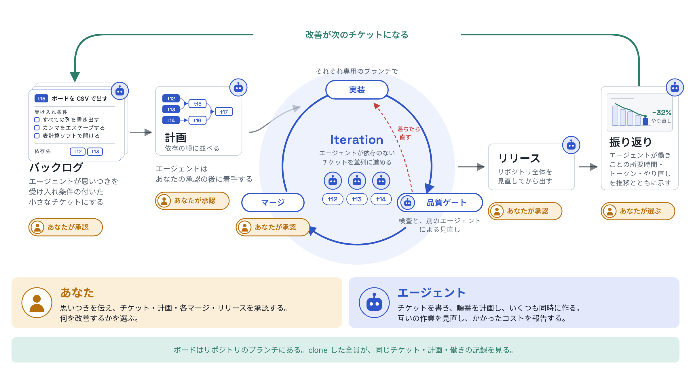
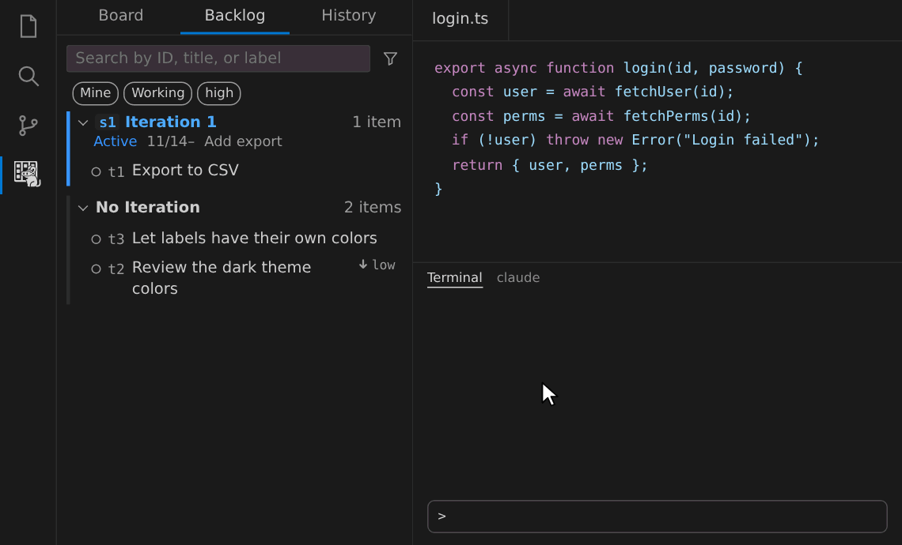
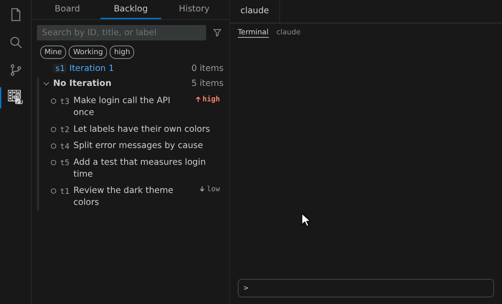
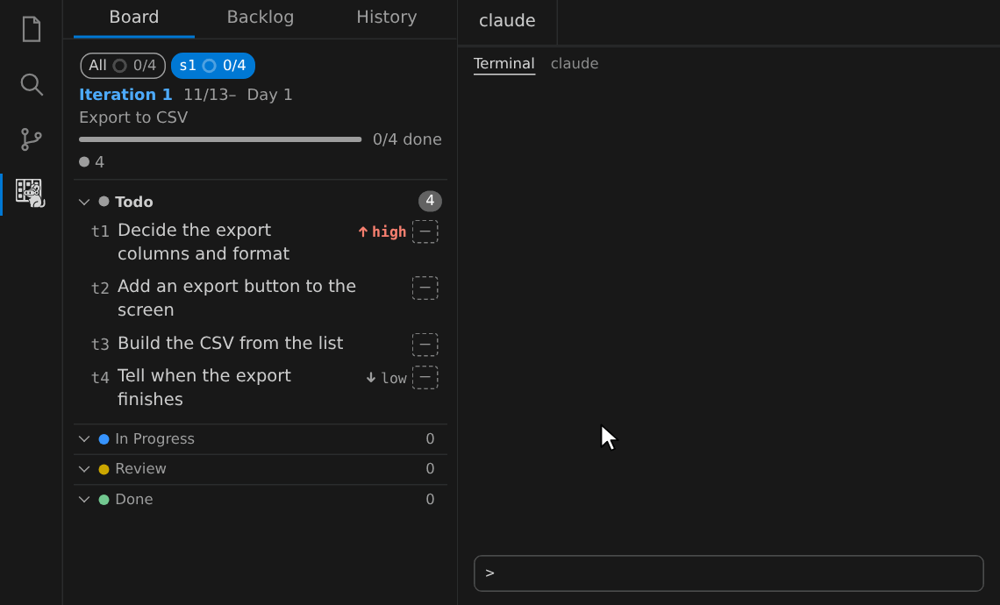
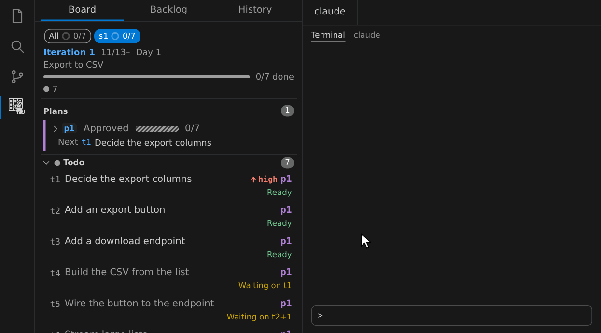
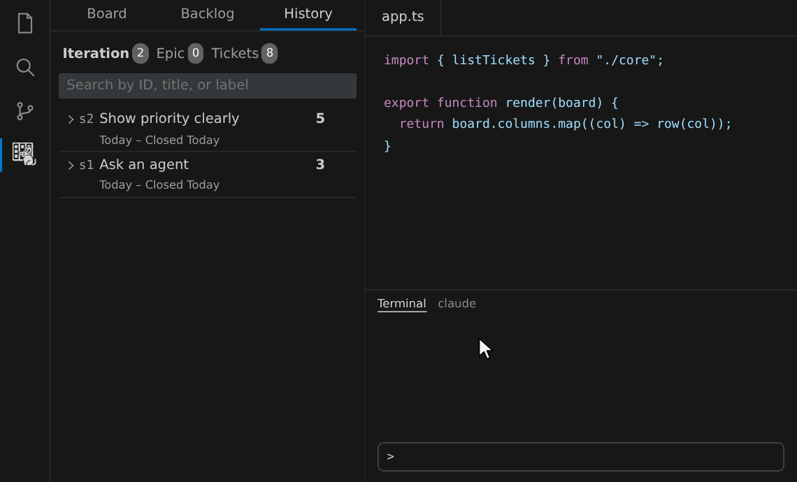

# deguboard

[English](README.md) | 日本語

AI エージェントと一緒にソフトウェアを作るための、Git リポジトリの中で動くカンバンボードです（[Agentic-Agile](https://github.com/microsoft/agentic-agile-template/blob/main/MANIFESTO.md) の実践）。人がアイデアを出すと、エージェントが受け入れ条件の付いた小さなチケットにし、並列に実装し、品質ゲートを通るまで見直しを繰り返します。エージェントの働きは計測され、振り返りで人がエージェントとソフトウェアの改善を考えます。

- **舵は人が握る**：エージェントは人が計画を承認してから着手し、PR は品質ゲート（検査と独立した見直し）が通ったときだけ ready・マージに進みます。AI に振り回されず、人と AI が協同で開発できます。
- **チームで使える**：ボードはリポジトリの専用ブランチにあるので、clone した全員が同じボードを見ます。サーバーもサービスも要りません。
- **測って改善する**：働きごとに工程の所要時間・トークン・やり直しを記録し、チームが承認した指標を傾向つきで見て、ボトルネックを次のチケットにします。



deguboard は独立したプロジェクトで、Microsoft が作ったものでも、推薦・支援するものでもありません。

## 導入

deguboard は Linux と macOS で動きます。Git 2.30 以上が要り、PR の状態をチケットに映すには GitHub CLI（`gh`）も要ります。

1. **拡張を入れる**：[GitHub Releases](https://github.com/brainpad-whiterabbit/deguboard/releases) の `deguboard-vscode.vsix` を取得し、`code --install-extension deguboard-vscode.vsix` で入れて、ウィンドウを再読み込みします。
2. **リポジトリで始める**：リポジトリを開き、Activity Bar の deguboard のアイコンを押して、**このリポジトリで始める** を押します。ボードを作り、Claude Code の Skill（`/dgplan` など）とフックをそのマシンに入れます。足された `.claude/.gitignore` をコミットします。
3. **ターミナルを使う人だけ**：`dg` を自分で呼ぶなら、コマンドパレットの **dg コマンドを入れる** を実行します。

チームの仲間は、拡張を入れて clone し、同じボタンを押せば同じボードが見えます。

## 使い方

Activity Bar の deguboard のアイコンを押します。上のタブで **バックログ**・**カンバン**・**履歴** を切り替えます。作業は、行や見出しの吹き出し（**エージェントに頼む**）から頼みます。頼むことを選び、コピーした依頼文をエージェントに貼るか、開いているターミナルに送ります。依頼文は `/dgplan s3` のような Claude Code の Skill なので、自分で打っても同じです。

### バックログ：思いつきをチケットにする

1. **起票する**：作りたいものを思いついたままの言葉で `/dgimport` に頼みます（**エージェントに頼む** → **起票する**）。エージェントがコードを調べ、受け入れ条件と依存の付いた小さなチケットの案を出します。承認するとバックログに並びます。

   

2. **詳細を読む**：行を押すとチケットが開きます。本文と属性はそこで直せます。
3. **検討する**：まだ曖昧なチケットは、**エージェントに頼む** → **検討する**（`/dgdiscuss t12`）を選びます。エージェントが論点を選択肢で相談して決め、変更を承認するとチケットに反映します。

### カンバン：割り当て、計画し、並列に進める

カンバンは Iteration のチケットを Status ごとの列に出し、上の帯にその Iteration の計画（Plan）を出します。

1. **割り当てる**：バックログで行の左端を押してチケットを選び、下の **頼む** → **割り当てる**（`/dgassign`）を選びます（1 件なら行の **エージェントに頼む** から）。エージェントが Iteration や Epic に入れる案を出し、承認するとカンバンの Todo に並びます。

   

2. **計画を立てる**：カンバンの見出しで **エージェントに頼む** → **計画を立てる**（`/dgplan s3`）を選びます。エージェントが依存から進める順を決め、Plan が上の帯に承認待ちで出ます。帯の状態を押すと依存のグラフが開きます。

   

3. **進める**：帯の Plan で **エージェントに頼む** → **Plan を進める**（`/dgwork p3`）を選びます。待ちのないチケットを、エージェントがそれぞれの作業ブランチと worktree で同時に実装し、PR を出します。PR は品質ゲートが通ったときだけ ready・マージに進みます。進むにつれて、グラフの色とカンバンの列が変わります。

   

### 履歴：振り返って改善する

終わった Iteration で **エージェントに頼む** → **振り返る** を選びます。エージェントが実績（工程ごとの所要時間とトークン、失敗、やり直し）を見せ、チームが承認した観点ごとの指標を傾向つきで計算して、承認した改善を起票します。



トークンは、会話記録から使用量を取り込む設定を有効にしたときだけ集計されます（Claude Code・Codex・Copilot CLI）。設定するには次のとおりにします。

```sh
dg config set metrics.read_transcripts true
```

設定はチームで共有されます。自分のマシンだけ止めるときは `DEGUBOARD_NO_TRANSCRIPTS=1` を設定します。

## ヒント

細部は[使い方の細部](docs/usage.ja.md)にあります。

- [最後まで任せる](docs/usage.ja.md#最後まで任せる)：`/dgall s3 --auto` で、Iteration を割り当てからリリースまで続けて進めます。
- [品質ゲートの段](docs/usage.ja.md#品質ゲートの段)：チケットごとに `high`（既定）・`low`・`free` を選べます。
- [同期の競合を解く](docs/usage.ja.md#同期の競合を解く)：二人が同じ項目を変えたときの解き方です。
- [承認待ちの通知](docs/usage.ja.md#承認待ちの通知)：承認待ちの Plan と review のチケットを知らせます。
- [チケットへ移動する](docs/usage.ja.md#チケットへ移動する)：ID かタイトルから詳細を開きます。
- [CLI で使う](docs/usage.ja.md#cli-で使う)・[Claude Desktop から使う（MCP）](docs/usage.ja.md#claude-desktop-から使う)
- シェルを使えるほかのエージェント（Codex・Copilot CLI など）は準備が要りません。「`dg guide` を読んでから `dg` で進めて」と頼みます。

## セキュリティとプライバシー

- 拡張はテレメトリを送らず、HTTP サーバーも起動しません。通信は `git` のリモートへの接続と、`gh` の GitHub への接続だけです。
- ボードのデータは `.git/deguboard/` に置きます。拡張は起動のたびに、`.git` の外へ次の 2 つだけを書きます。1 つ目は、ターミナルとフックが呼ぶ `dg` の起動ファイルと、同梱の `dg` を指す `current` で、`~/.local/share/deguboard/` に置きます。2 つ目は、リポジトリの `.claude/skills/` と `~/.claude/skills/` に入れてある dg の Skill（`dg*`）で、古い版の `dg` が書いたものだけを書き換えます（入れていない Skill は新しく入れません。新しい版の `dg` が書いた Skill は上書きしません。手で直した Skill は残し、警告を出します）。`~/.local/bin/dg` は「dg コマンドを入れる」でだけ書き、「dg コマンドを外す」で外します。拡張が呼ぶコマンドは `git`・`gh`・`dg --version` だけで、信頼したフォルダーでだけ動きます。
- Skill は `dg guide` を読ませる文面だけです。フックは `dg hook <イベント>` を呼ぶだけで、Run を記録し、`dg` を通さない PR の ready・マージとデータへの書き込みを拒みます。どちらも `--dry-run` で中身を見られます。
- 脆弱性の報告先は [SECURITY.md](SECURITY.md)（英語）にあります。

## ドキュメント

- [使い方の細部](docs/usage.ja.md)：この README に収めない使い方
- [要件定義書](docs/requirements.md)：今の仕様の正本
- [ADR](docs/adr/README.md)：設計判断の背景と理由
- [開発ガイド](docs/development.md)：このリポジトリで開発する人向け
- `dg --help` と `dg guide <topic>`：コマンドの一覧と、エージェント向けの手順の正本（CLI に同梱。英語）

## ライセンス

[MIT](LICENSE)。配布物に束ねた依存のライセンスは、ビルドで出る `THIRD_PARTY_LICENSES.md`（VSIX の `dist/`）にまとめています。
