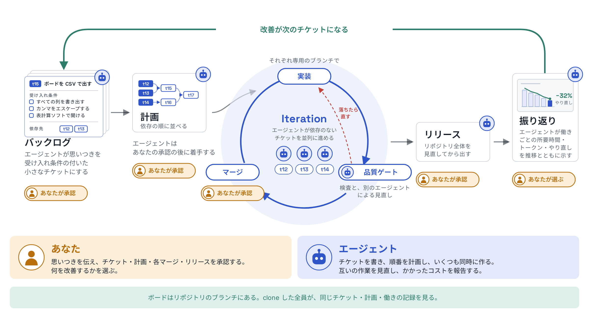
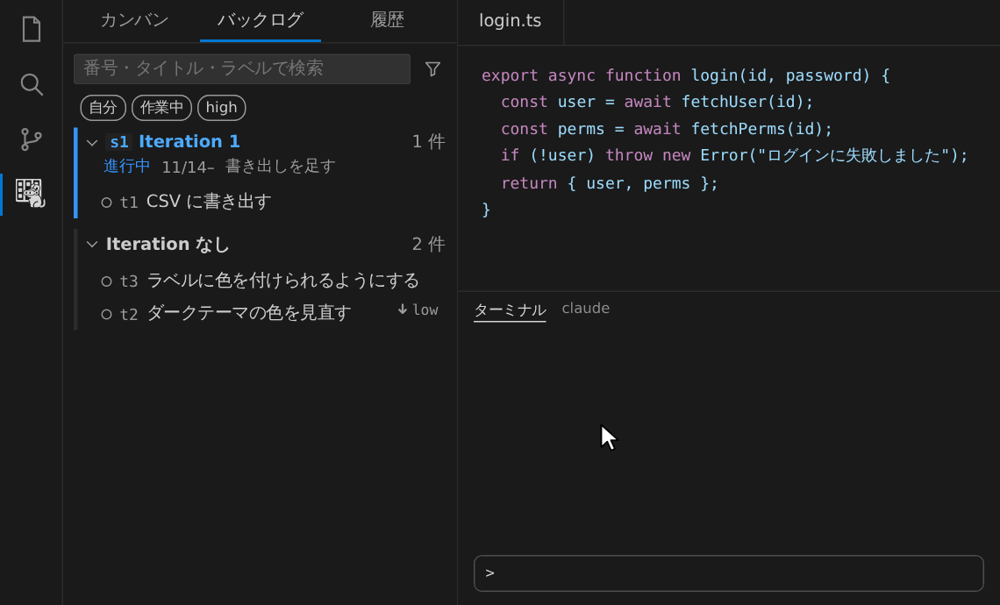
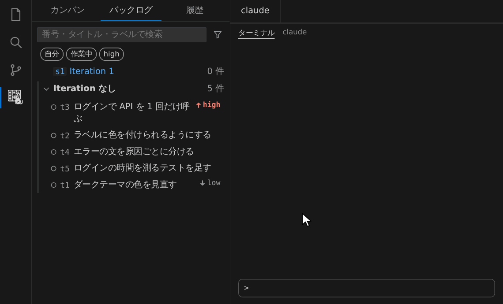
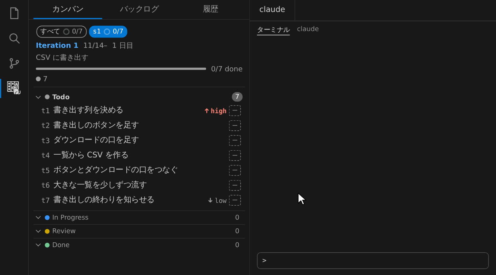
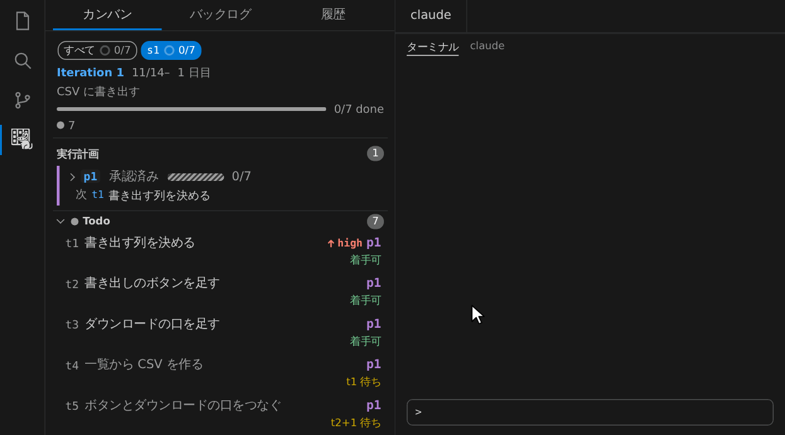
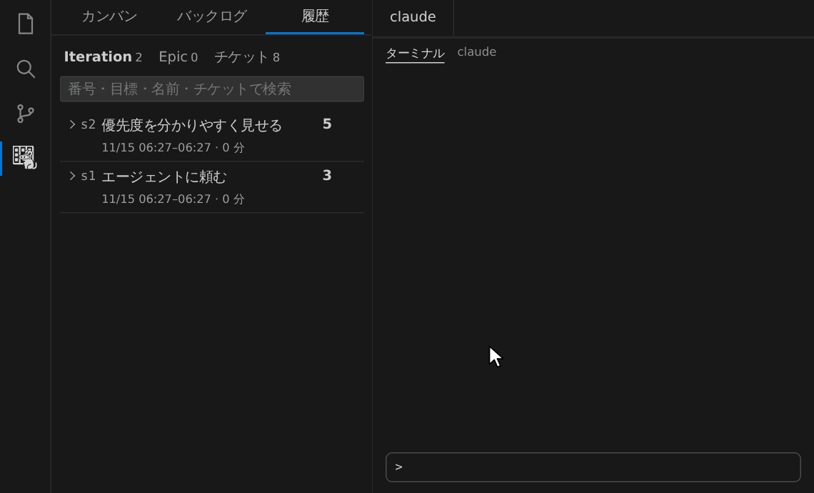

#  deguboard

[English](README.md) | 日本語

Git リポジトリの中で動く、AI エージェントと一緒に使うカンバンボードです。起票・計画・実装・見直し・リリース・振り返りまでの流れが組み込まれているので、エージェントに任せても品質を保ったままソフトウェアを育てられます。[Agentic-Agile](https://github.com/microsoft/agentic-agile-template/blob/main/MANIFESTO.md) に着想を得て、作者なりの Agentic-Agile のやり方を形にしました。

人がアイデアを出すと、エージェントがそれを受け入れ条件付きの小さなチケットに分け、並行して実装し、品質ゲートを通るまで手直しを続けます。エージェントの作業はすべて記録されるので、振り返りでは数字を見ながら、エージェントとソフトウェアのどこを良くするかを人が決められます。

- **主導権は人**：何を作り、何をリリースするかは人が決めます。エージェントはその範囲の中で作業を進め、人はそれを見守ります。エージェントに振り回されることはありません。
- **チームで共有**：ボードはリポジトリの専用ブランチに保存されるので、clone すれば誰でも同じボードを見られます。サーバーや外部サービスは要りません。
- **測って改善**：エージェントの作業ごとに、かかった時間・使ったトークン数・やり直しの回数を記録します。振り返りではチームで決めた指標の推移を見て、ボトルネックが見つかれば改善のチケットにして次の作業に組み込みます。

## 導入

deguboard は Linux と macOS で動きます。Git 2.30 以上が要り、PR の状態をチケットに映すには GitHub CLI（`gh`）も要ります。

1. **拡張を入れる**：[GitHub Releases](https://github.com/brainpad-whiterabbit/deguboard/releases) の `deguboard-vscode.vsix` を取得し、`code --install-extension deguboard-vscode.vsix` で入れて、ウィンドウを再読み込みします。
2. **リポジトリで始める**：リポジトリを開き、Activity Bar の deguboard のアイコンを押して、**このリポジトリで始める** を押します。ボードを作り、Claude Code の Skill（`/dgplan` など）とフックをそのマシンに入れます。足された `.claude/.gitignore` をコミットします。
3. **ターミナルを使う人だけ**：`dg` を自分で呼ぶなら、コマンドパレットの **dg コマンドを入れる** を実行します。

チームの仲間は、拡張を入れて clone し、同じボタンを押せば同じボードが見えます。

## 使い方

Activity Bar の deguboard のアイコンを押します。上のタブで **バックログ**・**カンバン**・**履歴** を切り替えます。作業は、行や見出しの吹き出し（**エージェントに頼む**）から頼みます。頼むことを選び、コピーした依頼文をエージェントに貼るか、開いているターミナルに送ります。依頼文は Skill の形と文章の形のどちらでも頼め、メニューで切り替えられます。

Claude Code では、「s3 を計画して」のように普通の言葉で言うだけでも、合う Skill が選ばれます。これは deguboard が入れた Skill を読む Claude Code が前提で、ほかのエージェントには文章の形で頼みます。Skill の一覧は、依頼の例とコマンドを含めて [使い方の細部](docs/usage.ja.md#skill-一覧) にあります。

### バックログ：思いつきをチケットにする

1. **起票する**：作りたいものを思いついたままの言葉で「この思いつきをチケットにして」のように頼みます（**エージェントに頼む** → **起票する**）。エージェントがコードを調べ、受け入れ条件と依存の付いた小さなチケットの案を出します。承認するとバックログに並びます。

   

2. **詳細を読む**：行を押すとチケットが開きます。本文と属性はそこで直せます。
3. **検討する**：まだ曖昧なチケットは、**エージェントに頼む** → **検討する** を選ぶか、「t12 を検討して」と言います。エージェントが論点を選択肢で相談して決め、変更を承認するとチケットに反映します。

### カンバン：割り当て、計画し、並列に進める

カンバンは Iteration のチケットを Status ごとの列に出し、上の帯にその Iteration の計画（Plan）を出します。

1. **割り当てる**：バックログで行の左端を押してチケットを選び、下の **頼む** → **割り当てる** を選びます（1 件なら行の **エージェントに頼む** から）。エージェントが Iteration や Epic に入れる案を出し、承認するとカンバンの Todo に並びます。

   

2. **計画を立てる**：カンバンの見出しで **エージェントに頼む** → **計画を立てる** を選びます。エージェントが依存から進める順を決め、Plan が上の帯に承認待ちで出ます。帯の状態を押すと依存のグラフが開きます。

   

3. **進める**：帯の Plan で **エージェントに頼む** → **Plan を進める** を選びます。待ちのないチケットを、エージェントがそれぞれの作業ブランチと worktree で同時に実装し、PR を出します。PR は品質ゲートが通ったら ready にし、人が承認したらエージェントがマージします。聞かずにマージするのは、`--auto` で config の `auto.merge` が true のときだけです。ゲートを満たさない場合は、承認で越えられるのは config で許した条件だけです。詳しくは[マージの承認の細部](docs/usage.ja.md#最後まで任せる)にあります。進むにつれて、グラフの色とカンバンの列が変わります。

   

### 履歴：振り返って改善する

終わった Iteration で **エージェントに頼む** → **振り返る** を選びます。エージェントが実績（工程ごとの所要時間とトークン、失敗、やり直し）を見せ、チームが承認した観点ごとの指標を傾向つきで計算して、承認した改善を起票します。承認した指標がまだない観点には、エージェントが推薦の指標を示すので、承認したものだけを採ります。

トークンは、会話記録から使用量を取り込む設定を有効にしたときだけ集計されます。有効にするしかたは[トークンを数える](docs/usage.ja.md#トークンを数える)にあります。

## 仕組み

チケットと Run はリポジトリのブランチに置き、画面もエージェントも同じ `dg` のコマンドを通り、フックがエージェントの手を借りずに Run を記録します。全体の構成と Run が記録する範囲は、[図で示しています](https://github.com/brainpad-whiterabbit/deguboard/blob/main/docs/how-it-works.ja.md)。

## ヒント

細部は[使い方の細部](docs/usage.ja.md)にあります。

- **カンバンの操作はエージェントに頼む**：一般のカンバンツールと違い、カードをドラッグで動かしたり、画面から起票したり、Iteration・Epic・Plan を操作したりするボタンは置いていません。**エージェントに頼む** から頼むと、Skill の点検と人の承認を経て変わります。チケット詳細では、本文や Status などの属性を直接直せます。人が直接できる操作は、今後増やすかもしれません。
- [最後まで任せる](docs/usage.ja.md#最後まで任せる)：「s3 を自動でリリースまで進めて」と頼むと、Iteration を割り当てからリリースまで続けて進めます。
- [品質ゲートの段](docs/usage.ja.md#品質ゲートの段)：チケットごとに `high`（既定）・`low`・`free` を選べます。
- [同期の競合を解く](docs/usage.ja.md#同期の競合を解く)：二人が同じ項目を変えたときの解き方です。
- [データを別のリポジトリに置く](docs/usage.ja.md#データを別のリポジトリに置く)：カンバンのデータを、コードとは別のリポジトリに置けます。
- [1 つのリポジトリに複数のカンバンを置く](docs/usage.ja.md#1-つのリポジトリに複数のカンバンを置く)：コードのリポジトリごとのブランチで、専用のリポジトリにカンバンを並べられます。
- [承認待ちの通知](docs/usage.ja.md#承認待ちの通知)：承認待ちの Plan と review のチケットを知らせます。
- [チケットへ移動する](docs/usage.ja.md#チケットへ移動する)：ID かタイトルから詳細を開きます。
- [CLI で使う](docs/usage.ja.md#cli-で使う)・[Claude Desktop から使う（MCP）](docs/usage.ja.md#claude-desktop-から使う)
- シェルを使えるほかのエージェント（Codex・Copilot CLI など）は準備が要りません。「`dg guide` を読んでから `dg` で進めて」と頼みます。フックが届かないエージェントでは、Run はエージェント自身の `dg run` の呼び出しでしか残らず、`dg pr merge` を経由しないマージを止めるものがありません。違いは[他のエージェントで使う](docs/usage.ja.md#他のエージェントで使う)にあります。

## セキュリティとプライバシー

- 拡張はテレメトリを送らず、HTTP サーバーも起動しません。通信は `git` のリモートへの接続と、`gh` の GitHub への接続だけです。
- 拡張が書き込む場所・実行するコマンドと、Skill とフックの振る舞いは、使い方の細部の[書き込む場所と実行するコマンド](docs/usage.ja.md#書き込む場所と実行するコマンド)にあります。
- 脆弱性の報告先は [SECURITY.md](SECURITY.md)（英語）にあります。

## ドキュメント

- [使い方の細部](docs/usage.ja.md)：この README に収めない使い方
- [仕組み](docs/how-it-works.ja.md)：全体の構成と、Run が記録する範囲を図で示します
- [要件定義書](docs/requirements.md)：今の仕様の正本
- [ADR](docs/adr/README.md)：設計判断の背景と理由
- [開発ガイド](docs/development.md)：このリポジトリで開発する人向け
- `dg --help` と `dg guide <topic>`：コマンドの一覧と、エージェント向けの手順の正本（CLI に同梱。英語）

## ライセンス

[MIT](LICENSE)。配布物に束ねた依存のライセンスは、ビルドで出る `THIRD_PARTY_LICENSES.md`（VSIX の `dist/`）にまとめています。
