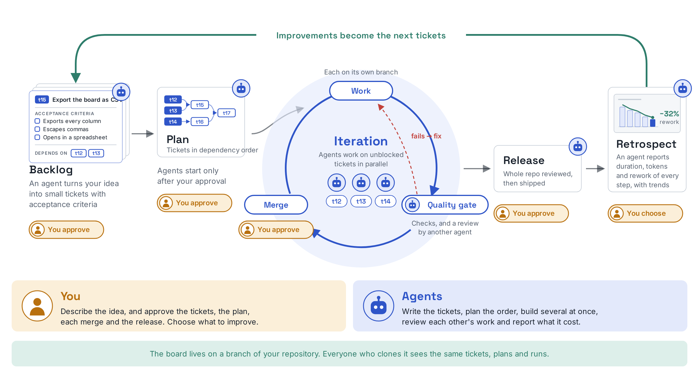
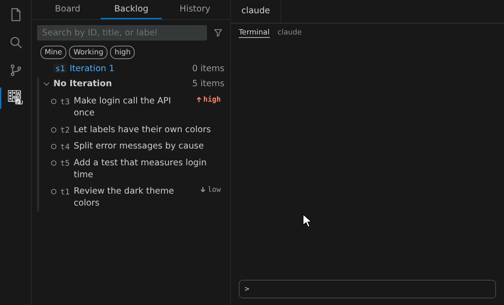
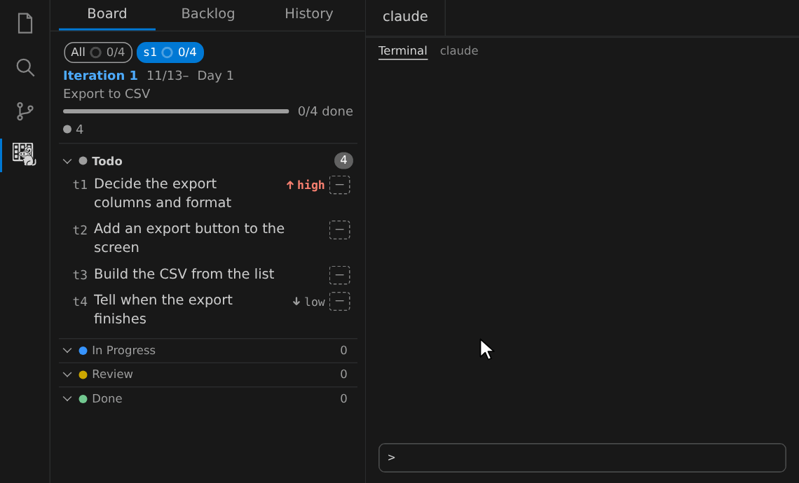
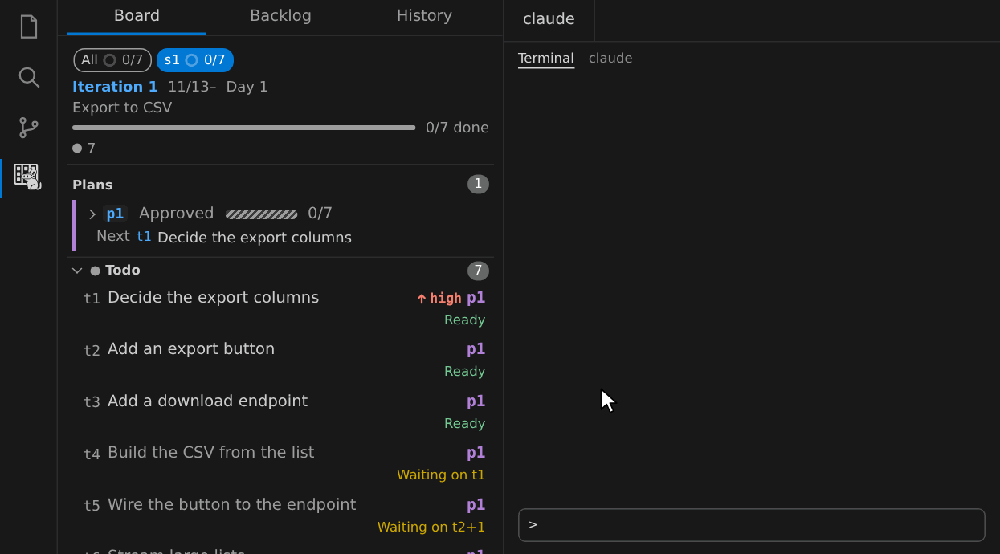

# deguboard

English | [日本語](https://github.com/brainpad-whiterabbit/deguboard/blob/main/README.ja.md)

A kanban board inside your Git repository for building software together with AI agents, as a way to practice [Agentic-Agile](https://github.com/microsoft/agentic-agile-template/blob/main/MANIFESTO.md). You bring the idea; agents turn it into small tickets with acceptance criteria, implement them in parallel, and keep revising each one until it passes the quality gate. Every agent run is measured, and in the retrospective you decide how to improve the agents and the software.

- **You stay in charge**: Agents start only after you approve the plan, and a PR becomes ready or merges only when the quality gate (the checks and an independent review) passes. You and the agents build together, without the AI running away with the work.
- **Made for teams**: The board lives on a dedicated branch of your repository, so everyone who clones it sees the same board. There is no server or service to run.
- **Measure and improve**: Each run records how long each step took, how many tokens it used, and how much rework it needed, and the metrics your team approved show their trend, so the bottlenecks become the next tickets.



deguboard is an independent project. It is not made, endorsed, or supported by Microsoft.

## Installation

deguboard runs on Linux and macOS. It needs Git 2.30 or later, and the GitHub CLI (`gh`) to show pull request status on tickets.

1. **Install the extension**: Download `deguboard-vscode.vsix` from [GitHub Releases](https://github.com/brainpad-whiterabbit/deguboard/releases), run `code --install-extension deguboard-vscode.vsix`, and reload the VS Code window.
2. **Start with the repository**: Open your repository, click the deguboard icon in the Activity Bar, and press **Start with this repository**. It creates the board and installs the Skills (such as `/dgplan`) and the hooks for Claude Code on your machine. Commit the `.claude/.gitignore` it adds.
3. **Terminal users only**: To run `dg` yourself, run **Install dg command** from the Command Palette.

Teammates install the extension, clone the repository, and press the same button to see the same board.

## Usage

Click the deguboard icon in the Activity Bar. The tabs at the top switch between **Backlog**, **Board**, and **History**. You ask for work with **Ask Agent**, the speech bubble on a row or a heading: choose what to ask for, then paste the copied request into your agent or send it to an open terminal. The requests are Skills for Claude Code such as `/dgplan s3`, so you can also type them yourself.

### Backlog: turn ideas into tickets

1. **Create tickets**: Tell the agent what you want in your own words with `/dgimport` (**Ask Agent** → **Create tickets**). It investigates the code and proposes small tickets with acceptance criteria and dependencies. Approve them, and they appear in the Backlog.
2. **Read the details**: Click a row to open the ticket. You can edit its text and attributes there.
3. **Discuss**: When a ticket is still vague, choose **Ask Agent** → **Discuss** (`/dgdiscuss t12`). The agent settles the open points with you through choices and updates the ticket after you approve the changes.


### Board: assign, plan, and work in parallel

1. **Assign**: Choose **Ask Agent** → **Assign** on tickets (`/dgassign`) to put them into an Iteration or an Epic. To ask about several tickets at once, select their rows by the left edge and press **Ask** at the bottom. The Board shows the tickets of the Iteration in columns by status.
2. **Plan**: Choose **Plan** on the Iteration (`/dgplan s3`). The agent orders the tickets by their dependencies and waits for your approval.
3. **Work**: Choose **Run Plan** on the plan in the band above the Board (`/dgwork p3`). Agents implement the tickets that are not blocked at the same time, each on its own branch and worktree, and open PRs. A PR becomes ready and merges only when the quality gate passes. The band above the Board shows the progress of the plan and its dependency graph.







### History: retrospect and improve

Choose **Ask Agent** → **Retrospect** on a finished Iteration. The agent shows the actuals (duration and tokens per step, failures, and rework), computes the metrics your team approved for each perspective with their trend, and files the improvements you approve as tickets.


Tokens are counted only when deguboard reads usage from conversation transcripts (Claude Code, Codex, and Copilot CLI). To turn it on:

```sh
dg config set metrics.read_transcripts true
```

The setting is shared with your team. To turn it off on your own machine only, set `DEGUBOARD_NO_TRANSCRIPTS=1`.

## Tips

The details are in the [usage guide](https://github.com/brainpad-whiterabbit/deguboard/blob/main/docs/usage.md) (in Japanese).

- [Hand off everything](https://github.com/brainpad-whiterabbit/deguboard/blob/main/docs/usage.md#最後まで任せる): `/dgall s3 --auto` runs an Iteration from assignment to release in one go.
- [Quality gate levels](https://github.com/brainpad-whiterabbit/deguboard/blob/main/docs/usage.md#品質ゲートの段): `high` (the default), `low`, or `free` per ticket.
- [Resolve a sync conflict](https://github.com/brainpad-whiterabbit/deguboard/blob/main/docs/usage.md#同期の競合を解く) when two people change the same field.
- [Notifications](https://github.com/brainpad-whiterabbit/deguboard/blob/main/docs/usage.md#承認待ちの通知) for Plans awaiting approval and tickets in review.
- [Go to Ticket](https://github.com/brainpad-whiterabbit/deguboard/blob/main/docs/usage.md#チケットへ移動する): jump to details by ID or title.
- [Use the CLI](https://github.com/brainpad-whiterabbit/deguboard/blob/main/docs/usage.md#cli-で使う) and [use it from Claude Desktop (MCP)](https://github.com/brainpad-whiterabbit/deguboard/blob/main/docs/usage.md#claude-desktop-から使う).
- Other agents that can use a shell (Codex, Copilot CLI, and others) need no setup: ask them to "read `dg guide` and proceed with `dg`".

## Security and privacy

- The extension sends no telemetry and starts no HTTP server. Its only network access is `git` connecting to your remotes and `gh` connecting to GitHub.
- Data is stored in `.git/deguboard/`, and nothing is written outside `.git`. The extension runs only `git`, `gh`, and `dg --version`, and only in trusted folders.
- The Skills only tell the agent to read `dg guide`. The hooks only call `dg hook <event>`, which records runs and refuses to mark a PR ready, merge it, or write to the data outside `dg`. See both with `--dry-run`.
- See [SECURITY.md](https://github.com/brainpad-whiterabbit/deguboard/blob/main/SECURITY.md) (in Japanese) for how to report vulnerabilities.

## Documentation

The documents below are written in Japanese.

- [Usage guide](https://github.com/brainpad-whiterabbit/deguboard/blob/main/docs/usage.md): the details that this README leaves out
- [Requirements](https://github.com/brainpad-whiterabbit/deguboard/blob/main/docs/requirements.md): the source of truth for the current specification
- [ADRs](https://github.com/brainpad-whiterabbit/deguboard/blob/main/docs/adr/README.md): background and reasons for design decisions
- [Development guide](https://github.com/brainpad-whiterabbit/deguboard/blob/main/docs/development.md): for people developing in this repository
- `dg --help` and `dg guide <topic>`: the list of commands and the source of truth for agent workflows (bundled with the CLI, in English)

## License

[MIT](https://github.com/brainpad-whiterabbit/deguboard/blob/main/LICENSE). Licenses of the dependencies bundled in the distributions are collected in `THIRD_PARTY_LICENSES.md`, generated by the build (in `dist/` of the VSIX).
