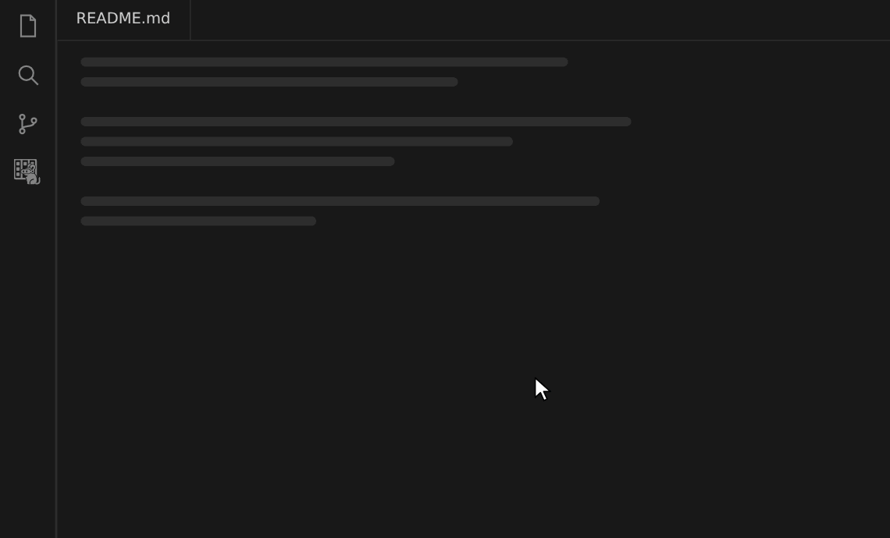
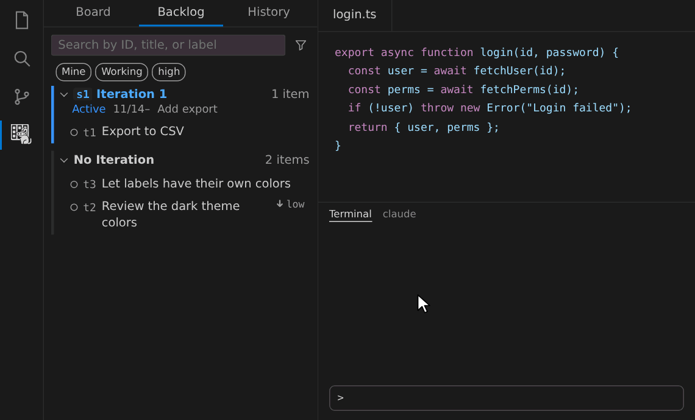
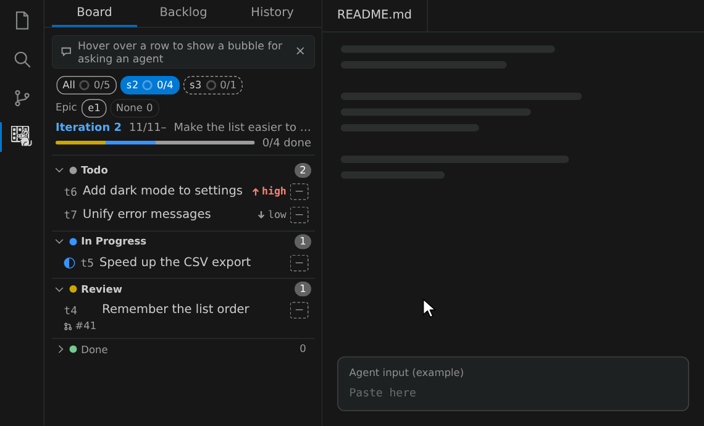
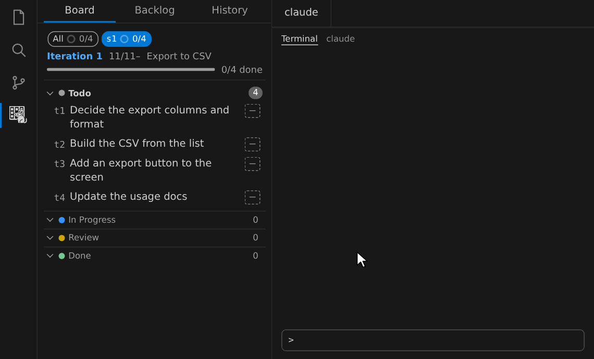
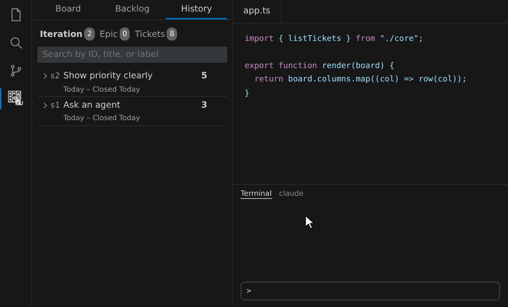

# deguboard

English | [日本語](https://github.com/brainpad-whiterabbit/deguboard/blob/main/README.ja.md)

A Git-native kanban board for practicing [Agentic-Agile](https://github.com/microsoft/agentic-agile-template/blob/main/MANIFESTO.md). You work as the agents' partner, designing, reviewing, and approving, while agents carry out small tickets with acceptance criteria in parallel along their dependencies. Every run is measured, so you can see where the work gets stuck and improve how you work together.

deguboard is an independent project. It is not made, endorsed, or supported by Microsoft.

> **Under development.** deguboard is not yet published to npm or the Marketplace. For now, clone and build `dg` and the VSIX yourself (see [Getting started before release](https://github.com/brainpad-whiterabbit/deguboard#getting-started-before-release)).

## Features

- **Delegate with specs**: Hand over work as small tickets with acceptance criteria instead of open-ended prompts. Agents work from the ticket, and the result is checked against its criteria.
- **Run in parallel along dependencies**: Plan the order from dependencies, and agents work on tickets that are not blocked at the same time, each on its own branch and worktree.
- **Governance built in**: Plans wait for approval before work starts. A PR is marked ready or merged only when the quality gate (`dg gate`) passes. Each ticket has a gate level, `high` by default, which requires everything including an independent review; `low` skips the review, and `free` checks only that the PR is open and does not conflict. `actor.human_only` and workflow rules can reserve commands and transitions for people, and the Claude Code hooks refuse to mark a PR ready or merge it outside `dg`, and to write to the data directly.
- **Measure and improve**: Aggregate duration, tokens, retries, review findings, and results per ticket, step, and model with `dg metrics`, and use retrospectives to find bottlenecks and what to fix next.

## Installation

Prerequisites: Linux or macOS, Git 2.30 or later, and Node.js 24 or later. To reflect pull request status on tickets, you also need the GitHub CLI (`gh`).

1. **Install the extension**: Search for "deguboard" in the Extensions view and install it. Before release, download `deguboard-vscode.vsix` from [GitHub Releases](https://github.com/brainpad-whiterabbit/deguboard/releases) and run `code --install-extension deguboard-vscode.vsix`.
2. **Install `dg`**: Run `npm i -g deguboard`. Before release, build it as described in [Getting started before release](https://github.com/brainpad-whiterabbit/deguboard#getting-started-before-release).
3. **Set up your repository**: Run this once in the repository you want to manage.

   ```sh
   cd <repository-to-manage>
   dg init
   ```

4. **Give your agent the workflows**: For Claude Code, install commands such as `/dgall`.

   ```sh
   dg skill install
   dg hooks install
   ```

   `dg hooks install` adds Claude Code hooks that mark the session as an agent and record the subagents you start with a first line `deguboard: ticket=<id> step=<step>` as Runs. The hooks also refuse to mark a PR ready or merge it outside `dg`, and to edit `.git/deguboard/` directly. Other agents that can use a shell (Codex, Copilot CLI, and others) need no setup. Just ask them to "read `dg guide` and proceed with `dg`".

5. **Open the board**: Click the deguboard icon in the Activity Bar.

Data lives on a dedicated branch of your repository, so no service is required. Other team members only need to clone the repository and run `dg init` to see the same board.

## Usage

### Open the board

Click the deguboard icon in the Activity Bar to open the board. Use the tabs at the top to switch to the backlog and history.



### Jump to details by ID or title

Run "deguboard: Go to Ticket" from the Command Palette, or press `Ctrl+K Ctrl+Alt+G` (`⌘K ⌘⌥G` on macOS), to filter tickets, Iterations, Epics, and Plans by ID or title and open their details.

### Use the keyboard

Rows in the sidebar (board, backlog, and history) work without a mouse. When you Tab into a list, only the current row is focusable, and a single Tab leaves the list.

| Key              | Action                                                                                                |
| ---------------- | ----------------------------------------------------------------------------------------------------- |
| ↑ ↓ / Home / End | Move between rows (the current row shows a focus outline)                                             |
| Enter            | Open details of the current row in an editor panel                                                    |
| Space            | Select or deselect the current row (keep adding to select several)                                    |
| a                | Open the "Ask Agent" menu for the selected rows (or the current row if none). Shift+F10 also opens it |

None of these conflict with VS Code's default keybindings.

### Turn a rough idea into tickets

Ask for something in your own words with `/dgimport` (in Claude Code). The agent investigates the code and proposes tickets with acceptance criteria and dependencies. Approve them, and they appear in the backlog.



### Ask an agent

Click a row's speech bubble, choose what to ask for, and paste the copied request into your agent. For agents other than Claude Code, set the format to "Text". You can also pick an open terminal and "Send" the request to it. A single line is typed into the input without pressing Enter. Multiple lines are pasted with VS Code's paste, so choose whether to paste when asked. If the input does not support pasting, each line may be run separately.



### Hand off everything

Describe what you want to build with `/dgall --auto` (in Claude Code), and the agent creates tickets, plans, and implements them in one go. It stops where approval is needed, such as releases, deleting, abandoning, or closing tickets, and merging PRs unless `auto.merge` is on. Which other decisions proceed without stopping is set by `auto.decisions` in config. Watch the progress on the board, and click a plan's band to see its dependencies as a graph. `--gate-high`, `--gate-low`, or `--gate-free` sets the quality gate level of the target tickets (without one, each ticket keeps its own level). For other agents, ask them to "read `dg guide all` and proceed to the end with `--auto`".



### Find bottlenecks

In the history, ask for "Retrospect" from a finished Iteration's speech bubble. The agent aggregates the actuals (duration, tokens, and rework per step) and summarizes where work got stuck and what to fix next.



To aggregate tokens as well, enable reading usage from conversation transcripts (supported for Claude Code, Codex, and Copilot CLI).

```sh
dg config set metrics.read_transcripts true
```

This setting is shared with your team. To turn it off on your own machine only, set `DEGUBOARD_NO_TRANSCRIPTS=1`.

### Notice what awaits approval

When Plans await approval or tickets are in review, the sidebar title shows the count, like "DEGUBOARD: Awaiting Approval/Review 3" (otherwise just "DEGUBOARD"). When the count grows, a notification appears, and "Open" opens the details. The number on the Activity Bar icon is something else: the total of unpushed commits and remote updates not yet pulled.

You can turn notifications off under "Notifications" in Settings (the gear icon); the count stays visible. To turn them off only for yourself while keeping the team setting, use the "Mine" (自分) tab in Settings or add `--local` (a personal setting that is not committed to Git; see `dg config set --help`).

```sh
dg config set notify.approvals false --local
```

## Security and privacy

- The extension sends no telemetry and starts no HTTP server. Its only network access is `git` connecting to your remotes and `gh` connecting to GitHub.
- Data is stored in `.git/deguboard/`, and nothing is written outside `.git`.
- The extension runs only `git`, `gh`, and `dg --version`, none of them through a shell (git running a merge driver with `sh -c` during a sync rebase is how git works).
- Because git configuration can run arbitrary commands, the extension works only in trusted folders (not in Restricted Mode or virtual workspaces).
- The Skills written by `dg skill install` contain only text telling the agent to read `dg guide`, with no scripts and no tool permissions. Use `--dry-run` to see their contents.
- The hooks written by `dg hooks install` only call `dg hook <event>`, which records Runs and reads transcripts under `~/.claude/projects/`. Before a tool runs, they also refuse `gh pr ready` and `gh pr merge` (and the same operations through `gh api`) outside `dg`, file-edit tools that write under `.git/deguboard/`, and Bash commands that mention `.git/deguboard`; use the `dg` commands instead. Use `--dry-run` to see the settings, and `dg hooks uninstall` to remove them.
- See [SECURITY.md](https://github.com/brainpad-whiterabbit/deguboard/blob/main/SECURITY.md) (in Japanese) for how to report vulnerabilities.

## Other ways to use it

### Getting started before release

Install [mise](https://mise.jdx.dev/), clone the repository, and put the built `dg` on your PATH. Outside the repository, Node.js 24 must also be on your PATH (with mise, `mise use -g node@24`).

```sh
git clone https://github.com/brainpad-whiterabbit/deguboard.git && cd deguboard
mise trust && mise install    # install node and pnpm at the versions in mise.toml
mise run install              # install dependencies, build dg and the extension, and install the VSIX into VS Code
mkdir -p ~/.local/bin && ln -sf "$PWD/packages/cli/bin/dg.js" ~/.local/bin/dg   # add ~/.local/bin to PATH if needed. To update, git pull and then mise run install
```

To install the VSIX by hand, run `code --install-extension packages/vscode/deguboard-vscode.vsix` after `mise run vsix`.

### Use the CLI

Without VS Code, you can run the same operations from the `dg` command.

```sh
dg ticket create "Validate login" --summary "Check the input" --acceptance "Reject empty input"
dg ticket list                # --json for machine-readable output
```

Without installing Skills, you can make the same requests by pasting text made with `dg ask --format text` into your agent.

### Use it from Claude Desktop (MCP)

`dg mcp` is a stdio MCP server that exposes `dg` commands as tools with names like `ticket_create`. Claude Desktop starts outside your repository without inheriting your PATH, so in `claude_desktop_config.json`, set `command` to the absolute path of node (`mise which node`), and pass the real path of `dg.js` (`realpath "$(which dg)"`) and `-C <target-repository>` as arguments. Claude Code can call `dg` through Bash, so it needs no registration.

```json
{
  "mcpServers": {
    "deguboard": {
      "command": "/path/to/node",
      "args": ["/path/to/deguboard/packages/cli/bin/dg.js", "-C", "/path/to/repo", "mcp"]
    }
  }
}
```

## Documentation

The documents below are written in Japanese.

- [Requirements](docs/requirements.md): the source of truth for the current specification
- [ADRs](docs/adr/README.md): background and reasons for design decisions
- [Development guide](docs/development.md): for people developing in this repository
- [SECURITY.md](SECURITY.md): where to report vulnerabilities and which versions receive fixes
- `dg --help` and `dg guide <topic>`: the list of commands and the source of truth for agent workflows (bundled with the CLI)

## License

[MIT](LICENSE). Licenses of the dependencies bundled in the distributions are collected in `THIRD_PARTY_LICENSES.md`, generated by the build (in `web/` of the npm package `deguboard` and in `dist/` of the VSIX).
