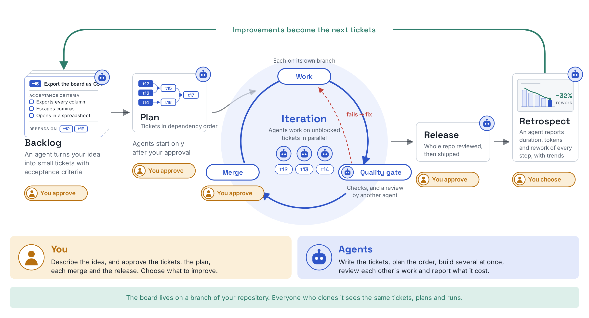
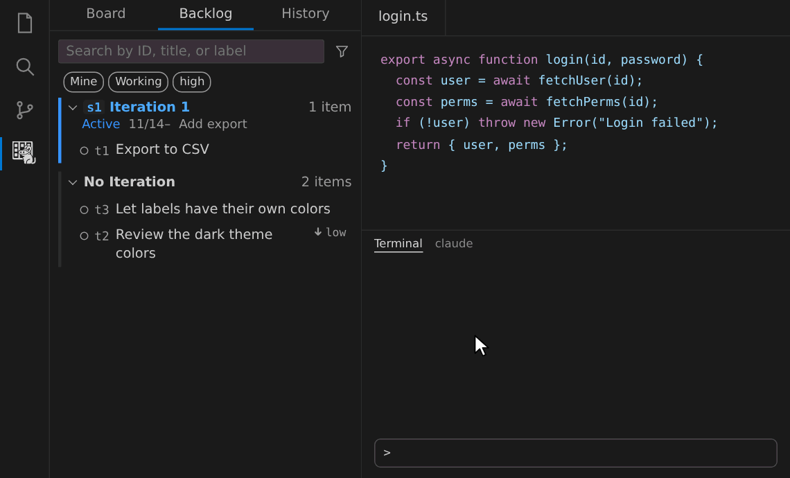
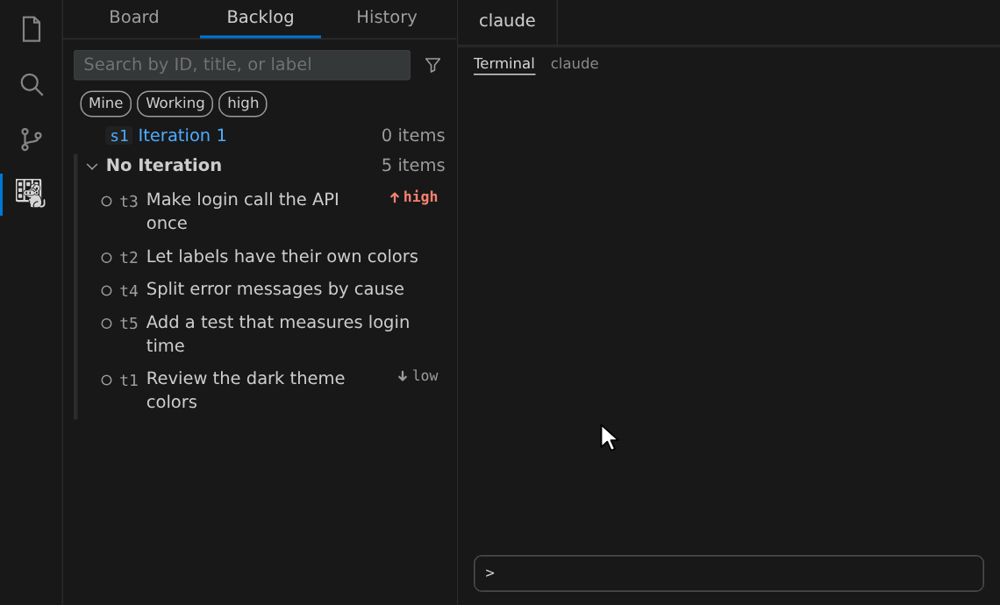
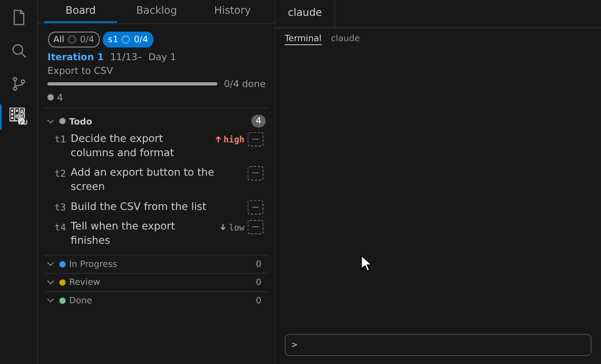
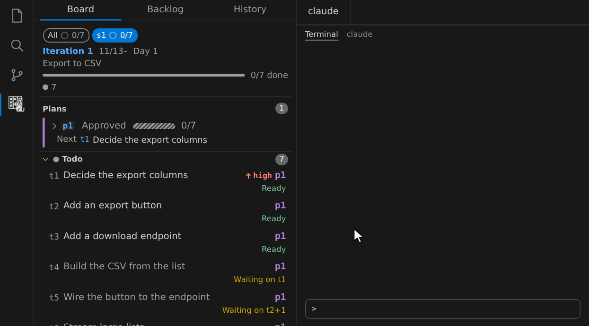
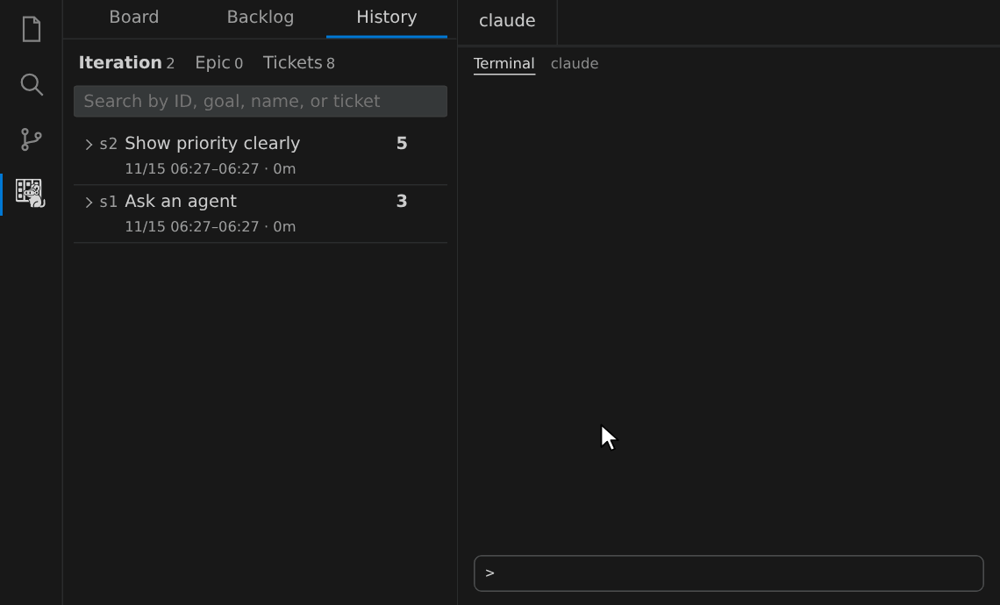

#  deguboard

English | [日本語](https://github.com/brainpad-whiterabbit/deguboard/blob/main/README.ja.md)

deguboard builds into your Git repository a development flow for handing development to AI agents, and its kanban board in VS Code is your window onto that flow, so you and AI agents can grow your software together while keeping its quality high. Inspired by [Agentic-Agile](https://github.com/microsoft/agentic-agile-template/blob/main/MANIFESTO.md), it supports our own take on Agentic-Agile. You bring the idea; agents turn it into small tickets with acceptance criteria, implement them in parallel, and keep revising each one until it passes the quality gate. Every agent run is measured, and in the retrospective you decide how to improve the agents and the software.

- **Rules enforced by the tool**: Agents follow dg's judgment, not promises in a prompt. The board's Workflow decides the Git facts that each Status move needs (such as a work branch or a PR) and where a person must approve, the quality gate decides whether a PR can be marked ready and merged, and dg refuses operations that break them. In Claude Code, the hooks also stop merges and direct data edits that bypass dg.
- **You stay in charge**: You decide what to build and what ships, and the agents drive the work forward within those bounds while you oversee them. By default, only a person can pass the release checkpoint and close an Iteration.
- **Made for teams**: The board lives on a dedicated branch of your Git repository, so everyone who clones it sees the same board. There is no server or service to run.
- **Measure and improve**: Every agent run records how long it took and how much rework it needed, and when your team turns on reading conversation transcripts, it also records how many tokens it used. In the retrospective, your team reviews the trends of the metrics it chose, and any bottleneck it finds becomes a ticket for the next round of work.

## Requirements

- **OS**: Linux or macOS.
- **VS Code**: 1.123 or later, the desktop edition.
- **Git**: 2.30 or later.
- **GitHub CLI (`gh`)**: optional. The pull request steps (opening, marking ready, and merging PRs, through `dg pr ready`, `dg pr merge`, and the agent's workflow actions) and showing pull request status on tickets need it. The board, the tickets, and reconciliation by Git facts work without it.
- **Agent**: Claude Code is the primary supported agent, and the Skills and hooks are made for it. Other agents that can run a shell, such as Codex and Copilot CLI, can also use `dg`; what changes without the hooks is under [Use other agents](https://github.com/brainpad-whiterabbit/deguboard/blob/main/docs/usage.md#use-other-agents).

## Installation

1. **Install the extension**: In VS Code, open the Extensions view, search for `deguboard`, and install **deguboard for VS Code**, or press Install on its [Marketplace page](https://marketplace.visualstudio.com/items?itemName=deguboard.deguboard-vscode). In an editor that cannot use the Marketplace, such as Cursor or VSCodium, download `deguboard-vscode.vsix` from [GitHub Releases](https://github.com/brainpad-whiterabbit/deguboard/releases), run **Extensions: Install from VSIX...** from the Command Palette, choose the file, and reload the window.
2. **Follow the checklist**: Open your repository, click the deguboard icon in the Activity Bar, and follow the setup checklist in the sidebar. The first item that is not met shows why. When a command can fix it, the item also shows a button and the command to run. When it cannot (for example, git is missing or a remote cannot be reached), fix it by hand and press Check again. At the board item, take in the team's board or create a new one. If your team keeps the board in another repository, choose that, enter the repository (a URL or a remote name) and its branch, and check it before you take the board in.
3. **Finish the recommended items**: Once the board is set up, the usual views appear, and a band above them lists the recommended items that are still missing. Install the Skills (such as `/dgplan`) and the hooks for Claude Code, install the `dg` command, and commit the `.claude/.gitignore` they add. Agents need the `dg` command as much as you do: the Skills and agents run `dg` in a shell to read and update the board. If you hide the band, the checklist icon (**Setup**) in the sidebar's title bar opens the checklist again at any time, and **Show the banner again** there brings the band back.

Teammates install the extension, clone the repository, and follow the same checklist to see the same board.

To stop using deguboard on this machine, in one clone, or as a team, follow [Uninstall](https://github.com/brainpad-whiterabbit/deguboard/blob/main/docs/usage.md#uninstall) in the usage guide. Uninstall the extension last.

## Usage

You run the board by asking agents. Unlike most kanban tools, there is no drag and drop, and there are no buttons for creating tickets or for changing Iterations, Epics, and Plans, so that every change goes through dg's rule checks, the Skill's checks, and your approval. In the ticket details you can still edit the text and attributes, including the status. We may let you do more directly in the future.

Click the deguboard icon in the Activity Bar. The tabs at the top switch between **Backlog**, **Board**, and **History**. You ask for work with **Ask Agent**, the speech bubble on a row or a heading: choose what to ask for, then paste the copied request into your agent or send it to an open terminal. The request comes in a Skill form and a plain-text form, and you can switch between them in the menu.

In Claude Code, you can also just say what you want in plain words, such as "Plan the tickets of s3", and the Skill that fits is chosen for you. This needs Claude Code, which loads the Skills that deguboard installs; other agents take the plain-text form. The list of Skills, with example requests and commands, is in the [usage guide](https://github.com/brainpad-whiterabbit/deguboard/blob/main/docs/usage.md#skills).

### Backlog: turn ideas into tickets

1. **Create tickets**: Tell the agent what you want in your own words, such as "Turn this idea into tickets" (**Ask Agent** → **Create tickets**). It investigates the code and proposes small tickets with acceptance criteria and dependencies. Approve them, and they appear in the Backlog.

   

2. **Read the details**: Click a row to open the ticket. You can edit its text and attributes there.
3. **Discuss**: When a ticket is still vague, choose **Ask Agent** → **Discuss**, or just say "Let's discuss t12". The agent settles the open points with you through choices and updates the ticket after you approve the changes.

### Board: assign, plan, and work in parallel

The Board shows the tickets of an Iteration in columns by status, and the band above it shows the Iteration's plans (Plan).

1. **Assign**: In the Backlog, select tickets by the left edge of their rows, then choose **Ask** → **Assign** at the bottom (for a single ticket, use **Ask Agent** on its row). The agent proposes the Iteration or Epic to put them into. Approve it, and they appear in Todo on the Board.

   

2. **Plan**: Choose **Ask Agent** → **Plan** on the Board's heading. The agent orders the tickets by their dependencies, and the Plan appears in the band, awaiting your approval. Click its state to open the dependency graph.

   

3. **Work**: Choose **Ask Agent** → **Run Plan** on the Plan in the band. Agents implement the tickets that are not blocked at the same time, each on its own branch and worktree, and open PRs. A PR becomes ready after it passes the quality gate, and the agent merges it after your approval. It merges without asking only with `--auto`, and only while the [board's Workflow](https://github.com/brainpad-whiterabbit/deguboard/blob/main/docs/usage.md#workflow) leaves that merge at `ask_unless_auto` (the default). If the gate is not met, your approval can override only the conditions allowed by the config; see the [merge approval details](https://github.com/brainpad-whiterabbit/deguboard/blob/main/docs/usage.md#hand-off-everything). As the work goes on, the colors in the graph and the columns of the Board change.

   

### History: retrospect and improve

Choose **Ask Agent** → **Retrospect** on a finished Iteration. The agent shows the actuals (duration and tokens per step, failures, and rework), computes the metrics your team approved for each perspective with their trend, and files the improvements you approve as tickets. For a perspective with no approved metric yet, the agent proposes a recommended metric, and only the ones you approve are adopted.

Tokens are counted only when deguboard reads usage from conversation transcripts. [Count tokens](https://github.com/brainpad-whiterabbit/deguboard/blob/main/docs/usage.md#count-tokens) in the usage guide explains how to turn it on.

## Why deguboard

With an MCP server, agents can read and write tickets in Jira or GitHub Projects too, but how the work proceeds and whether the rules are kept is left to the agent's instructions. deguboard puts the development flow itself in dg:

- **Next step from facts** — dg returns the one next step from the ticket, its branch, PR, and Runs, so stopped work resumes with the same request.
- **Parallel by default** — a claim creates a branch and worktree per ticket; agents work the unblocked tickets in parallel.
- **Rules enforced, not requested** — dg refuses operations that lack a recorded human approval, and hooks stop merges and data edits that bypass dg.
- **Measured** — each piece of agent work is recorded as a Run, and retrospectives compute the metrics your team chose.
- **No server** — the board lives on a branch of your repository; install the extension and go. MIT licensed.

Trade-offs: the board is for people who clone the repository (no web view for non-engineers), integrates with Git and GitHub only, and its hooks work in full only in Claude Code. See [the full comparison](https://github.com/brainpad-whiterabbit/deguboard/blob/main/docs/how-it-works.md#compared-with-a-ticket-tool-and-mcp).

## How it works

Tickets and Runs live in a branch of your repository, every screen and agent goes through the same `dg` commands, and hooks record each Run without the agent's help. [How it works](https://github.com/brainpad-whiterabbit/deguboard/blob/main/docs/how-it-works.md) shows the overall structure and what each Run records, with diagrams, and compares deguboard with a ticket tool and MCP.

## Tips

The details are in the [usage guide](https://github.com/brainpad-whiterabbit/deguboard/blob/main/docs/usage.md).

- [Hand off everything](https://github.com/brainpad-whiterabbit/deguboard/blob/main/docs/usage.md#hand-off-everything): say "Carry s3 through to release automatically", and the agent runs the tickets of the Iteration from the check to release in one go. By default it asks you to pass the release checkpoint and to close the Iteration.
- [Quality gate levels](https://github.com/brainpad-whiterabbit/deguboard/blob/main/docs/usage.md#quality-gate-levels): `high` (the default), `low`, or `free` per ticket.
- [Resolve a sync conflict](https://github.com/brainpad-whiterabbit/deguboard/blob/main/docs/usage.md#resolve-a-sync-conflict) when two people change the same field.
- [Keep the data in another repository](https://github.com/brainpad-whiterabbit/deguboard/blob/main/docs/usage.md#keep-the-data-in-another-repository), away from the code.
- [Keep several kanbans in one repository](https://github.com/brainpad-whiterabbit/deguboard/blob/main/docs/usage.md#keep-several-kanbans-in-one-repository), one branch per code repository.
- [Approval notifications](https://github.com/brainpad-whiterabbit/deguboard/blob/main/docs/usage.md#approval-notifications) for Plans awaiting approval and tickets in review.
- [Go to Ticket](https://github.com/brainpad-whiterabbit/deguboard/blob/main/docs/usage.md#go-to-ticket): jump to details by ID or title.
- [Use the CLI](https://github.com/brainpad-whiterabbit/deguboard/blob/main/docs/usage.md#use-the-cli) and [use it from Claude Desktop (MCP)](https://github.com/brainpad-whiterabbit/deguboard/blob/main/docs/usage.md#use-it-from-claude-desktop-mcp).
- [Write the agent instructions](https://github.com/brainpad-whiterabbit/deguboard/blob/main/docs/usage.md#write-the-agent-instructions): a few lines in `CLAUDE.md` or `AGENTS.md` keep requests that match no Skill on the board, and give the release steps.
- Other agents that can use a shell (Codex, Copilot CLI, and others) need no setup: ask them to "read `dg guide` and proceed with `dg`". The differences are in [Use other agents](https://github.com/brainpad-whiterabbit/deguboard/blob/main/docs/usage.md#use-other-agents).

## Security and privacy

- The extension sends no telemetry and starts no HTTP server. Its only network access is `git` connecting to your remotes and `gh` connecting to GitHub.
- What the extension writes, which commands it runs itself, what it types into a terminal when you press a button, and what the Skills and hooks do are in [What it writes and runs](https://github.com/brainpad-whiterabbit/deguboard/blob/main/docs/usage.md#what-it-writes-and-runs) in the usage guide.
- See [SECURITY.md](https://github.com/brainpad-whiterabbit/deguboard/blob/main/SECURITY.md) for how to report vulnerabilities.

## Documentation

The documents below are written in Japanese, except the usage guide and How it works, which are in English.

- [Usage guide](https://github.com/brainpad-whiterabbit/deguboard/blob/main/docs/usage.md): the details that this README leaves out
- [How it works](https://github.com/brainpad-whiterabbit/deguboard/blob/main/docs/how-it-works.md): the overall structure and what each Run records, with diagrams, and the comparison with a ticket tool and MCP
- [Requirements](https://github.com/brainpad-whiterabbit/deguboard/blob/main/docs/requirements.md): the source of truth for the current specification
- [ADRs](https://github.com/brainpad-whiterabbit/deguboard/blob/main/docs/adr/README.md): background and reasons for design decisions
- [Development guide](https://github.com/brainpad-whiterabbit/deguboard/blob/main/docs/development.md): for people developing in this repository
- `dg --help` and `dg guide <topic>`: the list of commands and the source of truth for agent workflows (bundled with the CLI, in English)

## Built with deguboard

deguboard is developed with [Claude Code](https://claude.com/product/claude-code) and deguboard itself: changes start as tickets on this repository's own board, and agents carry them through the quality gate to a [pull request](https://github.com/brainpad-whiterabbit/deguboard/pulls?q=is%3Apr+is%3Amerged) that names the ticket ID.

## License

[MIT](https://github.com/brainpad-whiterabbit/deguboard/blob/main/LICENSE). Licenses of the dependencies bundled in the distributions are collected in `THIRD_PARTY_LICENSES.md`, generated by the build (in `dist/` of the VSIX).
