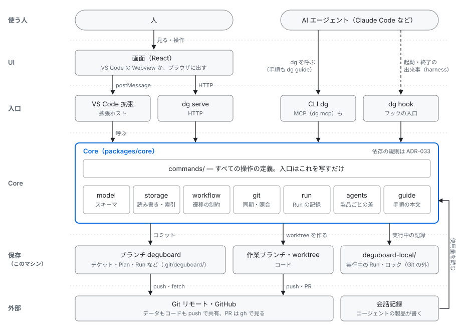
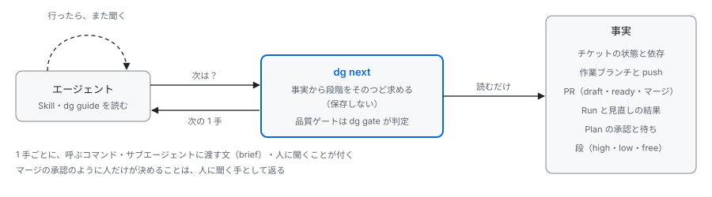
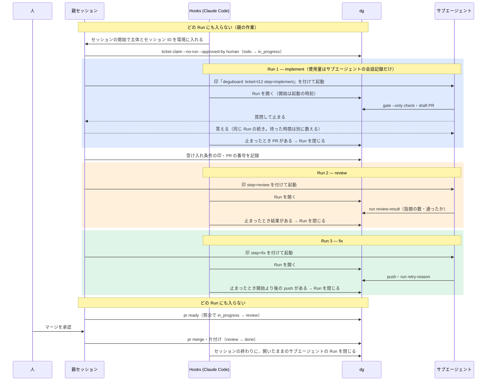

# 仕組み

[English](how-it-works.md) | 日本語

このページでは、deguboard の全体の構成と、Run がどこからどこまでを記録するかを説明します。操作の仕方は[使い方の細部](usage.ja.md)に、約束は[要件定義書](requirements.md)（正本）に、判断の理由は [ADR](adr/README.md) にあります。このページはそれらを写しません。

## 全体の構成

矢印は依存と呼び出しの向きです。人とエージェントは入口を通り、入口はどれも Core の同じコマンドを呼びます。Core だけがデータを読み書きします。

- **入口**：VS Code 拡張・`dg serve`・CLI と MCP・`dg hook` は、Core の同じコマンドを写すだけで、ロジックを持ちません。フックの出来事の判定（Run を開く・閉じる、ツールの呼び出しを拒む）も Core にあり、フックの速い経路も同じ関数を呼びます。画面からの操作も、エージェントの `dg` も、同じ結果になります
- **Core**：ドメインのモデル・保存・カンバンの Workflow・Git の同期と照合・Run の記録・guide の本文を持ちます。エージェントの製品ごとの違い（フックの入力・会話記録の読み方）は `agents` に閉じ込めます。どのパッケージがどれに依存してよいかの規則は [ADR-033](adr/ADR-033-architecture.md) にあります
- **データ**：チケット・Epic・Iteration・Plan・Run は、1 件 1 ファイルで、データのリモート（`git.data_remote`。空なら `git.remote`）の orphan ブランチ（既定は `deguboard`。`git.data_branch`）に置き、push すればチームと共有されます。置き場所は変えられます（[データを別のリポジトリに置く](usage.ja.md#データを別のリポジトリに置く)・[1 つのリポジトリに複数のカンバンを置く](usage.ja.md#1-つのリポジトリに複数のカンバンを置く)）。サーバーやデータベースはありません。実行中の Run の記録とロックは、このマシンの `deguboard-local/` に置き、Git には入れません
- **照合**：`dg sync` が作業ブランチと PR の事実を見て、チケットを進めます（PR が ready になったら review、マージされたら done）
- **エージェント**：Skill か `dg guide <topic>` で手順を読み、`dg next` が返す次の一手を `dg` で進めます。Run はエージェントでなく、harness のフックが `dg hook` を通して記録します（[Run の記録の範囲](#run-の記録の範囲)と [ADR-025](adr/ADR-025-runs-by-hooks.md)）

## エージェントが次の一手を決める仕組み

エージェントは手順を覚えて動くのではありません。`dg next` に聞くたびに、dg がチケット・作業ブランチ・PR・Run・Plan（承認と待ち）・段の事実からその時点の段階を求め、次の 1 手を返します。段階は保存しないので、途中で止まっても同じ問いで続きから再開できます。

エージェントは、dg が返す 1 手だけを行い、また聞きます。マージの承認のように人だけが決めることは、dg が「人に聞く」手として返します。

### この節の決まり

- 手順の中身は dg にあり（Skill・`dg guide`・`dg next`。Skill も dg が同梱する手順）、エージェントは事実を見て、返った 1 手を行う
- 段階を保存しないので、止まっても `dg next` で続きから戻れる
- 人が決めること（マージの承認・リリース・やめる）は dg が止めて聞く。段（gate）で見直しの有無が変わる

### 書かないこと（リンク先）

- 手の一覧とやり方 → `dg guide work`・`dg next --help`
- 品質ゲートの条件 → [品質ゲートの段](usage.ja.md#品質ゲートの段)・`dg gate --help`
- 手順を guide の文章でなく dg に持たせた理由 → [ADR-011](adr/ADR-011-procedure-in-code.md)・[ADR-030](adr/ADR-030-flow-and-guide-in-core.md)

## Run の記録の範囲

Run は、1 回の AI の作業（実装・見直し・手直し）の記録で、使用量（トークン）と時間を持ちます。下の図の色の付いた区間が、それぞれ 1 つの Run です。区間の外の親セッションの作業は、どの Run にも入りません。

### 範囲の決まり

- **開く**：親が頼む文の 1 行目に印 `deguboard: ticket=<id> step=<step>` を書いてサブエージェントを起動すると、フックがその Run を開きます。印のない起動（調べものなど）は Run になりません
- **閉じる**：サブエージェントが止まったとき、その step を終えた事実（実装は PR、見直しは結果の記録、手直しは開始より後の push）があれば閉じます。なければ閉じずに待ち、再開した後の作業も同じ Run に数えます
- **使用量**：その Run のサブエージェントの会話記録だけから数えます。エージェントの自己申告の数字は書きません。数えるのは `metrics.read_transcripts` が true のときだけです（既定は false なので、設定するまで使用量は空のままです。[トークンを数える](usage.ja.md#トークンを数える)）。親セッションのトークンは、どの Run にも入りません

### 図に描いていない場合

- 段（gate）が `low`・`free` のチケットには、見直しと手直しの Run がありません（[品質ゲートの段](usage.ja.md#品質ゲートの段)）
- フックが届かないエージェントでは、印で頼んだサブエージェントの Run は記録されません。親が自分で進める作業は claim が Run を開きます。届いているかは `dg hooks check` で確かめます（[他のエージェントで使う](usage.ja.md#他のエージェントで使う)）
- 持ち主のない見直しの結果（開いている見直しの Run がなく、フックも取らなかったもの。フックが届かない環境など）は、結果を書いた時刻に閉じた見直しの Run として数えます。`dg next` と `dg gate` が数え、`dg sync` と `dg pr ready` がそれを Git に書いて Run に結び付けます（[ADR-025](adr/ADR-025-runs-by-hooks.md)）
- 次の区切り（同じチケットの次の Run の開始・PR の ready かマージ・チケットの終わり）が来ても開いたままの手直しの Run は、最後の push で成功として閉じます。閉じるのは次の開始か `dg sync` です（細部は `dg sync --help`）
- 使用量とツールの回数は、`metrics.read_transcripts` が true でなければ空のままです。既定は false です（[トークンを数える](usage.ja.md#トークンを数える)）
- 落ちたセッションの残りなど端のケースは、`dg hook --help` と [ADR-025](adr/ADR-025-runs-by-hooks.md) にあります
