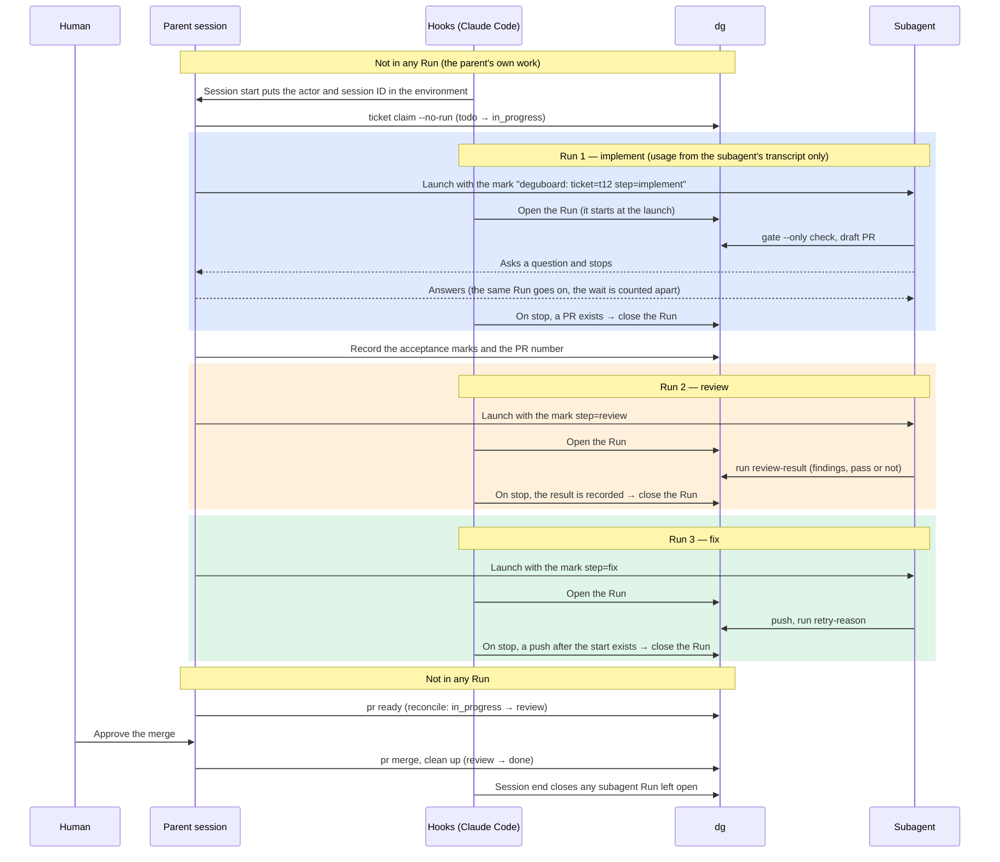

# How it works

English | [日本語](how-it-works.ja.md)

This page shows how deguboard is put together, and what each Run records from start to end. How to do things is in the [usage details](usage.md), the promises are in [requirements.md](requirements.md) (written in Japanese), which is the source of truth, and the reasons for the decisions are in the [ADRs](adr/README.md). This page does not copy them.

## Overview

Arrows show the direction of dependency and calls. People and agents go through the entry points, and every entry point calls the same commands of Core. Only Core reads and writes the data.

- **Entry points**: the VS Code extension, `dg serve`, the CLI and MCP, and `dg hook` only map the same commands of Core and hold no logic. The judgment for a hook event (what opens or closes a Run, what a tool call refuses) is also in Core, and the CLI's fast path for hooks calls the same functions. An operation on a screen and an agent's `dg` call give the same result
- **Core**: holds the domain model, storage, the board's Workflow, Git sync and reconcile, Run records, the Actions for software development, and the guide texts. What differs between agent products (hook input, how to read transcripts) is kept inside `agents`. The rule of which package may depend on which is in [ADR-033](adr/ADR-033-architecture.md)
- **Data**: tickets, Epics, Iterations, Plans, and Runs are files, one per item, on an orphan branch (`deguboard` by default, set by `git.data_branch`) of the data remote (`git.data_remote`, or the code's remote when it is empty). Pushing it shares them with your team. Where it is kept can be changed: see [Keep the data in another repository](usage.md#keep-the-data-in-another-repository) and [Keep several kanbans in one repository](usage.md#keep-several-kanbans-in-one-repository). There is no server or database. The records of running Runs and the locks stay in `deguboard-local/` on your machine, outside Git
- **Reconcile**: `dg sync` reads the facts of work branches and PRs, and moves tickets forward (to review when the PR is ready, to done when it is merged)
- **Agents**: read the steps from the Skills or `dg guide <topic>`, and carry out the next step that `dg next` returns with `dg`. Runs are recorded not by the agent but by the harness's hooks, through `dg hook` (see [How Runs are recorded](#how-runs-are-recorded) and [ADR-025](adr/ADR-025-runs-by-hooks.md))

## How the agent decides the next step

An agent does not carry the steps in its memory. Each time it asks `dg next`, dg derives the stage from the facts of the ticket, its work branch, its PR, its Runs, its Plan (approval and waits), and its gate level, and returns one next step. The stage is not stored, so after a stop the same question resumes the work.

The agent carries out only the one step that dg returns, then asks again. A decision that only a person makes, such as approving a merge, is returned by dg as a step that asks a person.

### Rules of this section

- The steps are in dg (the Skills, `dg guide`, and `dg next`; the Skills are also steps that dg ships): the agent looks at the facts and carries out the one step returned
- The stage is not stored, so when the work stops, `dg next` resumes it from the same facts
- Decisions that a person makes (approving a merge, release, or stopping a ticket) are stopped by dg, which asks. The gate level changes whether the review is done

### Linked, not written here

- The steps and how each runs → `dg guide work` and `dg next --help`
- The conditions of the quality gate → [Quality gate levels](usage.md#quality-gate-levels) and `dg gate --help`
- Why the steps are in dg, not in the guide text → [ADR-011](adr/ADR-011-procedure-in-code.md) and [ADR-030](adr/ADR-030-flow-and-guide-in-core.md)

## How Runs are recorded

A Run is the record of one piece of AI work (implement, review, or fix), with its usage (tokens) and time. Each colored span below is one Run. The parent session's work outside the spans is in no Run.

### What a Run covers

- **Opens**: when the parent launches a subagent with the mark `deguboard: ticket=<id> step=<step>` on the first line of its request, the hook opens that Run. A launch without the mark (such as research) is not a Run
- **Closes**: when the subagent stops and the fact that ends the step exists (a PR for implement, a recorded result for review, a push after the start for fix). Without the fact, the Run stays open and waits, and the work after a resume counts in the same Run
- **Usage**: counted only from that subagent's transcript, never from numbers the agent reports, and only when `metrics.read_transcripts` is true (it is false by default, so usage stays empty until it is set; see [Count tokens](usage.md#count-tokens)). The parent session's tokens are in no Run

### Cases not drawn

- Tickets whose gate is `low` or `free` have no review or fix Runs ([Quality gate levels](usage.md#quality-gate-levels))
- Where the hooks do not reach the agent, the Runs of marked subagents are not recorded; work the parent does itself gets its Run from the claim. Check with `dg hooks check` ([Use other agents](usage.md#use-other-agents))
- A review result that no Run owns (no review Run is open and no hook has taken it, as when the hooks do not reach the agent) counts as a review Run closed when the result was written. `dg next` and `dg gate` count it, and `dg sync` and `dg pr ready` write it into Git and attach it to that Run ([ADR-025](adr/ADR-025-runs-by-hooks.md))
- A fix Run still open when the next boundary comes (the next Run starts on the ticket, the PR is ready or merged, or the ticket ends) is closed with success at its last push, by the next start or by `dg sync` (details in `dg sync --help`)
- Usage and tool counts stay empty unless `metrics.read_transcripts` is true, which is false by default ([Count tokens](usage.md#count-tokens))
- Edge cases, such as what a crashed session leaves, are in `dg hook --help` and [ADR-025](adr/ADR-025-runs-by-hooks.md)
