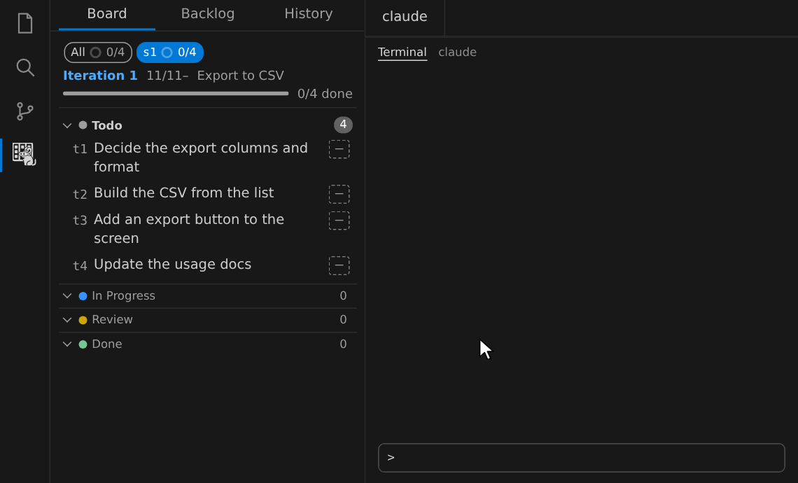

# 使い方の細部

[README](../README.ja.md) の「使い方」に収めない、人がする操作をまとめる。コマンドの細部は `dg <コマンド> --help`、エージェントの手順は `dg guide <topic>`、約束は [requirements.md](requirements.md) が正本で、ここには写さない。

## 最後まで任せる

Claude Code で `/dgall s3 --auto` のように Iteration かチケットを渡すと、エージェントが割り当て・計画・実装・見直し・リリースを続けて進める。作りたいものの起票はしないので、先に `/dgimport` でチケットにする。

- `--auto` を付けると、config の `auto.decisions` に入っている判断は提案の選択肢で進む。リリース、チケットをやめる・削除する、Epic・Iteration を閉じるなど、人が決めることでは止まって聞く（一覧は `dg guide all`）
- 品質ゲートを通った PR のマージは、config の `auto.merge` が true のときだけ自動で行う
- 進み具合はカンバンで見られ、計画の帯を押すと依存のグラフが出る
- Claude Code 以外のエージェントには「`dg guide all` を読んで、`--auto` で最後まで進めて」と頼む



## 品質ゲートの段

PR を ready にする・マージするときに判定する条件は、チケットの段（`gate`）で変わる。

| 段             | 判定する条件                        |
| -------------- | ----------------------------------- |
| `high`（既定） | 検査と独立した見直しを含むすべて    |
| `low`          | 見直しを除く（検査はする）          |
| `free`         | PR が開いていて、衝突しないことだけ |

段はチケット詳細か `dg ticket update <id> --gate <段>` で付ける。`/dgall`・`/dgwork` に `--gate-high`・`--gate-low`・`--gate-free` を付けると、対象のチケットの段をまとめて決める（付けなければ各チケットの段のまま）。段を下げるのは人の指示があるときだけにする。条件の細部は `dg gate --help`。

## 同期の競合を解く

同じチケットの同じ項目を二人が違う値に変えると、同期は push の前で止まり、通知に競合した項目の remote と local の値が並ぶ。

- 通知の「Take remote」か「Take local」を押すと、競合した項目だけがその側の値になる（ほかの変更は残る）。ターミナルでは `dg sync --resolve remote` か `dg sync --resolve local`
- 解くまで、push と、起票・claim のようにすぐ push する書き込みは待つ
- `config.yaml` やワークフローの競合にはボタンが出ない。`dg sync` の警告にある手順で、人が手で解く

エージェント向けの手順は `dg guide overview` の「When sync stops」、細部は `dg sync --help`。

## 承認待ちの通知

承認待ちの Plan と review のチケットがあると、サイドバーのタイトルに件数が出て（「DEGUBOARD: 承認待ち 3」）、増えたときは通知が出る。通知の「開く」で詳細が開く。Activity Bar のアイコンの数字は別で、未 push のコミットと未取り込みのリモートの更新の合計を示す。

通知は設定画面（歯車）の「通知」で切れる（件数の表示は残る）。チームの設定のまま自分だけ切るときは、設定画面の「自分」のタブか `--local` を使う。

```sh
dg config set notify.approvals false --local
```

## チケットへ移動する

コマンドパレットの「deguboard: チケットへ移動」（Go to Ticket）か `Ctrl+K Ctrl+Alt+G`（macOS は `⌘K ⌘⌥G`）で、チケット・Iteration・Epic・Plan を ID かタイトルで絞り込んで詳細を開く。

## CLI で使う

画面と同じ操作をターミナルの `dg` でも行える。コマンドパレットの「dg コマンドを入れる」（Install dg command）が `~/.local/bin/dg` を張る（PATH に `~/.local/bin` がなければ足す）。

```sh
dg ticket create "ログインの検証" --summary "入力の検査" --acceptance "空のとき拒否する"
dg ticket list                # --json で機械向け
dg --help                     # コマンドの一覧
```

Skill を入れていないエージェントには、`dg ask --format text` で作った文章を貼って頼める。

## Claude Desktop から使う

`dg mcp` は stdio の MCP サーバーで、`dg` のコマンドをツールとして出す。`claude_desktop_config.json` の `command` に、拡張が入れる起動ファイル `~/.local/share/deguboard/dg` の絶対パスを書き（JSON は `~` を展開しないので、macOS は `/Users/<you>/...`、Linux は `/home/<you>/...`）、引数に `-C <対象のリポジトリ>` と `mcp` を渡す。Claude Code は Bash で `dg` を呼べるので、登録は要らない。

```json
{
  "mcpServers": {
    "deguboard": {
      "command": "/Users/<you>/.local/share/deguboard/dg",
      "args": ["-C", "/path/to/repo", "mcp"]
    }
  }
}
```
