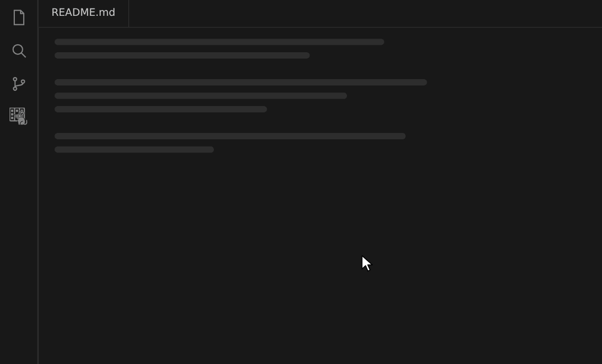
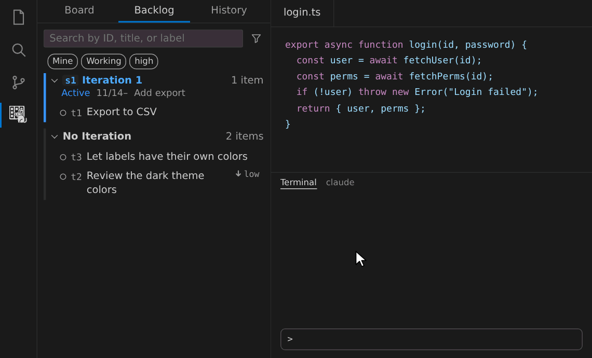
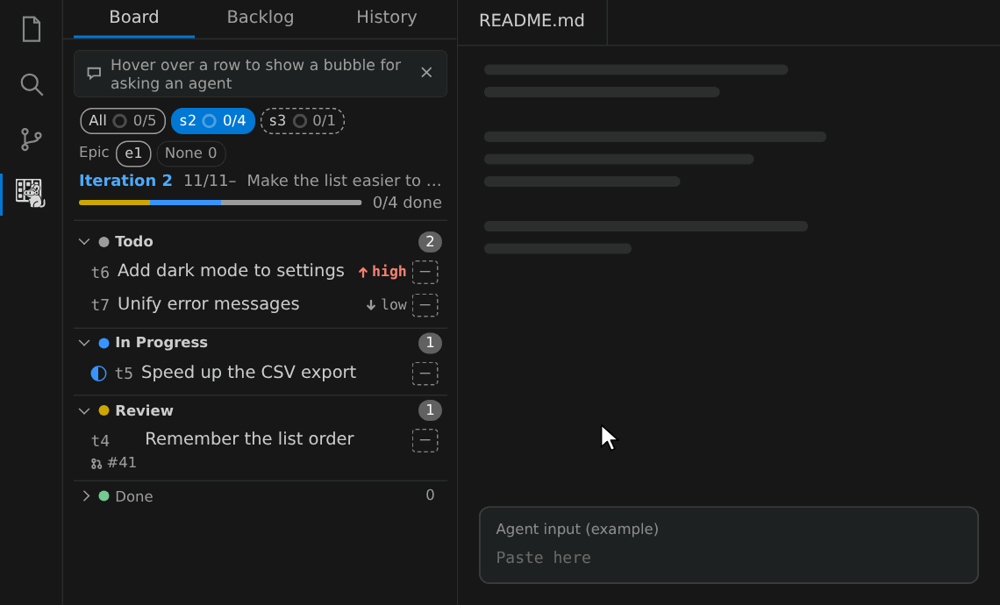
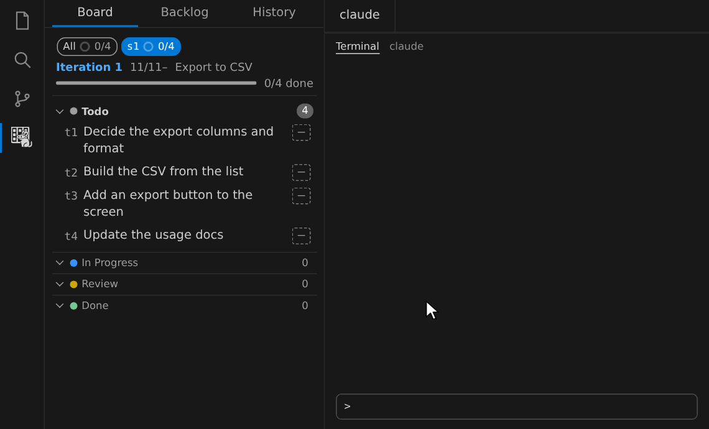
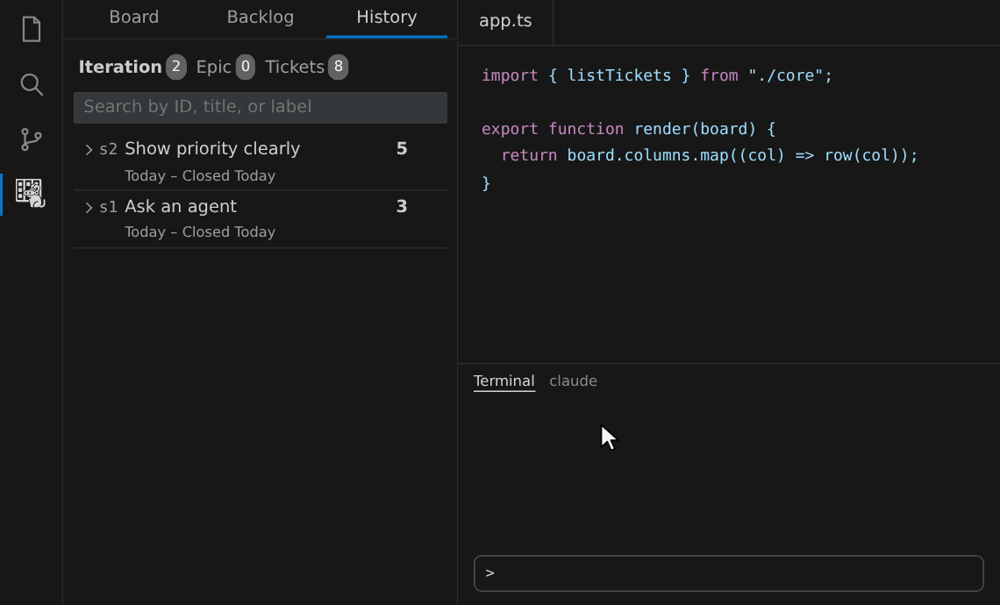

# deguboard

AI エージェントに仕事を任せるための、Git リポジトリの中で動くカンバンです。仕事を小さなチケットに分けてエージェントに渡し、依存に沿って並列に進め、その働きを測って改善できます。Claude Code・Codex・GitHub Copilot など、コマンドを実行できるエージェントならどれでも使えます。

## 特長

- **任せる仕事を小さくそろえる**：仕事をチケットに分けるので、エージェントに渡す 1 回の作業が小さく、同じくらいの大きさにそろいます。チケットごとに受け入れ条件を確かめるので、品質を保てます。
- **依存に沿って並列に進める**：チケットの依存から進める順を計画し、待ちのないチケットは同時に進めます。品質を落とさずに、速く仕上がります。
- **エージェントの働きを測る**：作業のたびに所要時間・トークン・結果を記録し、チケット・工程・モデルごとに集計します。どこで時間やトークンを使っているか、ボトルネックを調べられます。
- **エージェントを選ばない**：エージェントはコマンドラインツール `dg` でチケットを読み書きし、進め方の手順も `dg guide` から受け取ります。Claude Code・Codex・Copilot CLI など、シェルを使えるエージェントならどれでも使えます。チケットごとにエージェントを使い分けて、実績を比べることもできます。
- **サービスがいらない**：チケットも記録も同じリポジトリの専用ブランチに保存されます。push するだけで、チームで同じボードを見られます。
- **VS Code の中で完結**：カンバン・バックログ・履歴をサイドバーで見て、吹き出しから依頼文をコピーしてエージェントに頼めます。エージェントが書いた変更はすぐ画面に映ります。

## 導入

必要なもの：Git、Node.js 24 以上。PR の状態をチケットに映すときは GitHub CLI（`gh`）も使います。

1. **拡張を入れる**：拡張機能ビューで「deguboard」を検索してインストールします。
2. **コマンドラインツール `dg` を入れる**：エージェントは `dg` でチケットを読み書きします。

   ```sh
   npm i -g deguboard
   ```

3. **リポジトリで準備する**：管理したいリポジトリで一度だけ実行します。チケットを置くブランチができ、リモートがあれば push されます。

   ```sh
   cd <管理したいリポジトリ>
   dg init
   ```

4. **エージェントに手順を渡す**：Claude Code では、`/dgall` などのコマンドを使えるようにします。

   ```sh
   dg skill install
   ```

   Codex・Copilot CLI などほかのエージェントでは準備は要りません。「`dg guide` を読んでから `dg` で進めて」と頼みます。

5. **ボードを開く**：Activity Bar の deguboard のアイコンを押します。

チームの 2 人目からは、リポジトリを clone して `dg init` を実行すると同じボードが見えます。画面を見るだけなら `dg` がなくても動きます。

## 使い方

### ボードを開く

Activity Bar の deguboard のアイコンを押すと、サイドバーにカンバンが開きます。上のタブでバックログと履歴に切り替えます。



### 雑な指示からチケットを起票する

思いついたままの一言で頼むと、エージェントがコードを調べて、小さなチケットに分けた起票の案を出します。案には概要・受け入れ条件・優先度・依存が入り、承認するとバックログに並びます。Claude Code では `/dgimport` を付けて頼みます。



### エージェントに頼む

行にマウスを載せて吹き出しを押し、頼むことを選びます。指示を書いてコピーし、エージェントの入力欄に貼ります。Claude Code 以外のエージェントには、形式を「文章」にしてコピーします。



### 最後まで任せる

作りたいものを書いて `/dgall --auto`（Claude Code の場合）を付けて頼むと、エージェントがチケットを起票し、進める順を計画して、1 件ずつ仕上げます。ボードでは、チケットが Todo から In Progress へ進み、すべて Done になるまでを見守れます。計画の帯を押すと、どのチケットがどれを待っているかをグラフで見られます。ほかのエージェントでは「`dg guide all` を読んで、`--auto` で最後まで進めて」と頼みます。



### ボトルネックを調べる

履歴で終わった Iteration の吹き出しから「振り返る」を選び、調べたいことを書いて頼みます。エージェントは記録した実績（工程ごとの所要時間・トークン・差し戻し）を集計し、どこが詰まっていたかと次に直すことを分析レポートにまとめます。



トークンも集計するには、エージェントの会話記録から使用量を取り込む設定を有効にします（Claude Code・Codex・Copilot CLI に対応）。

```sh
dg config set metrics.read_transcripts true
```

## セキュリティとプライバシー

- 拡張は外部のサーバーと通信せず、テレメトリ（利用状況の送信）もしない。画面のために HTTP サーバーも起動しない
- データはリポジトリの `.git/deguboard/` に置く。書くのは `.git` の中だけ
- 拡張が外部のコマンドとして呼ぶのは `git` と、入っていれば PR の状態の照合に使う `gh`（GitHub CLI）。`dg` は同梱せず、PATH にあれば版を確かめるために `dg --version` だけを呼ぶ。エージェントや CLI から使う `dg` は利用者が呼ぶ。拡張はどれも引数配列で直接実行し、シェルを通さない（同期の rebase で git が登録済みのマージドライバ（中身は `dg merge-driver`）を `sh -c` で動かすのは git の仕様）。通信が起きるのは、`git` がリモートに接続するとき（fetch・push・ls-remote）と、`gh` が GitHub に接続するときだけ
- 制限モード（信頼していないフォルダー）と仮想ワークスペースでは動かない。リポジトリの git の設定（`core.fsmonitor` など）が任意のコマンドを実行させ得るため。フォルダーを信頼したときだけ使える
- 脆弱性の報告先と修正の対象の版は [SECURITY.md](https://github.com/brainpad-whiterabbit/deguboard/blob/main/SECURITY.md)
